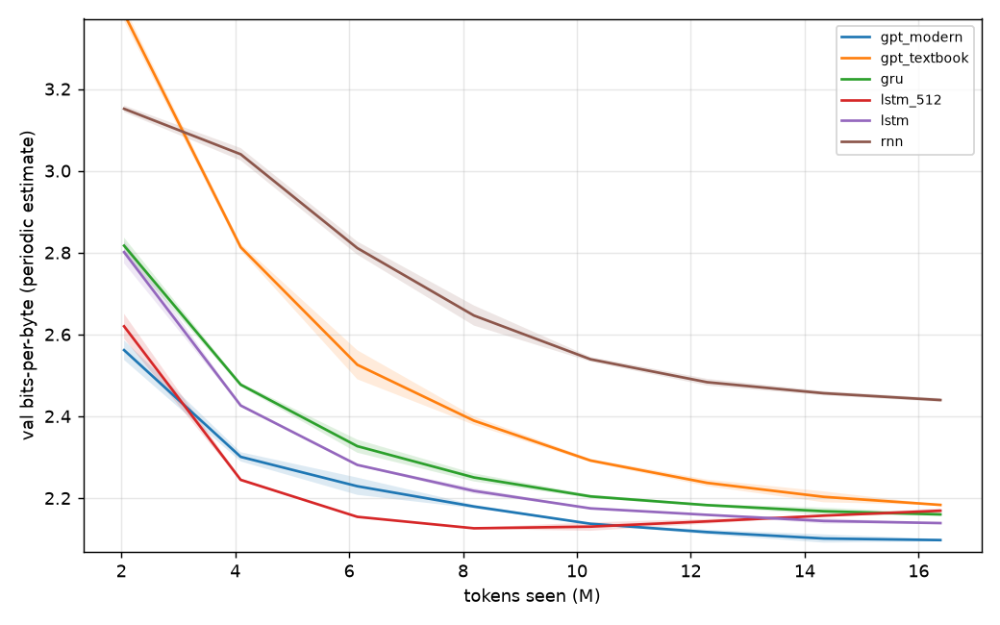
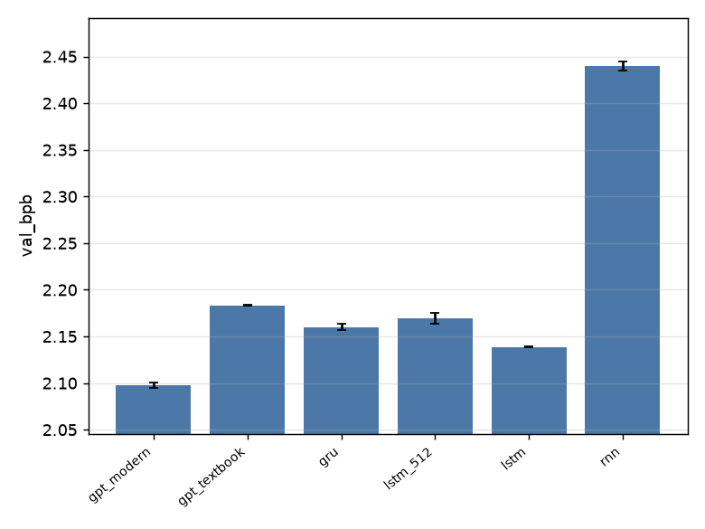
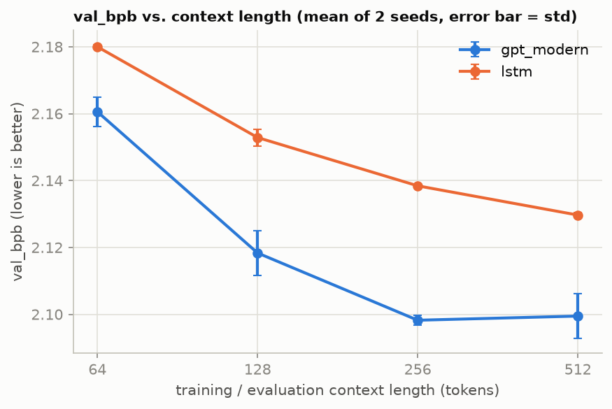
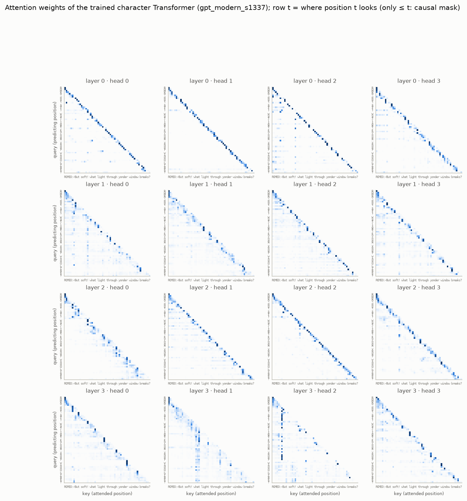
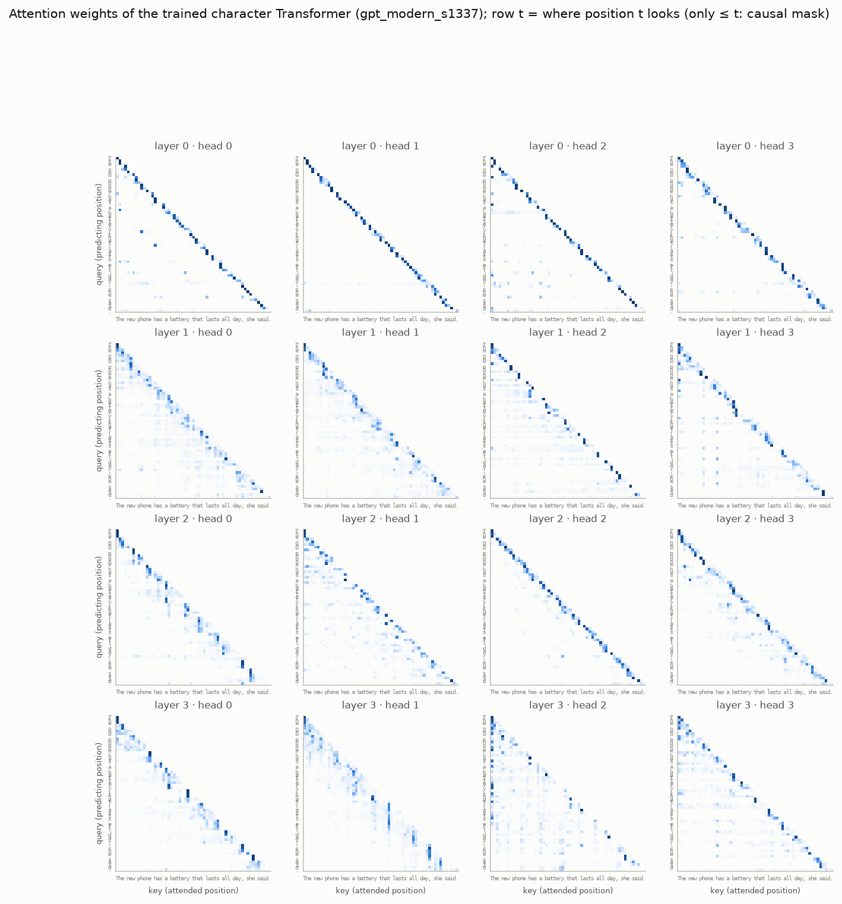
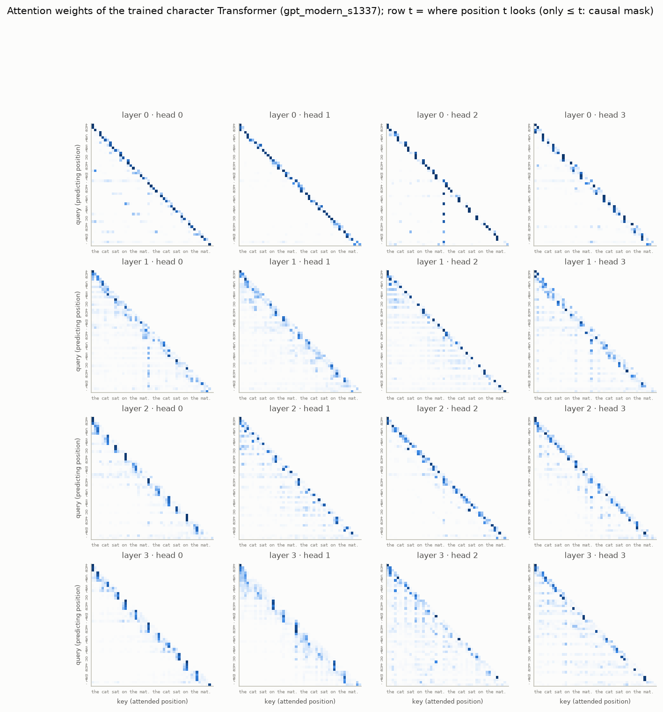
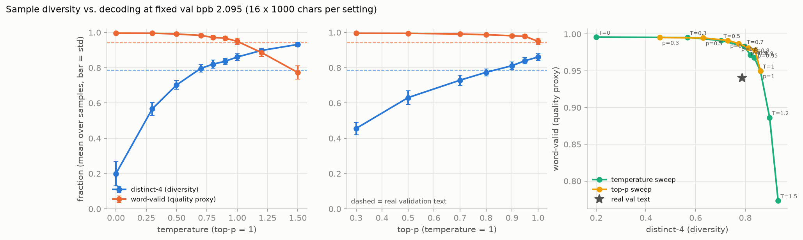

# HW 1 — Language Models from Scratch (Part 1)

## Goal

This homework studies language-model metrics and compares recurrent models with
Transformers in practice. The experiments use the `nanolm` implementation in the
DeepDataMiningLearning repository and the Tiny Shakespeare character dataset.

---

## Setup / Prerequisites

### Environment

| Item | Value |
|---|---|
| Base commit | `8418fc1` (`main`) |
| Conda environment | `test` |
| Python / PyTorch | 3.11.17 / 2.11.0+cu128 |
| GPU | NVIDIA GeForce RTX 5080 (16 GB), CUDA, bfloat16 |

### Running the experiments

All commands in this report are run from the `llm` directory, with the `test`
environment active:

```bash
conda activate test
cd DeepDataMiningLearning/llm
```

Every training run writes to `outputs/nanolm/<date>_<time>_<name>/`. Sweep runs
write to `outputs/nanolm/sweeps/<sweep>/<run>_s<seed>/`. Each run directory
contains `config.yaml`, `metrics.json`, `train_log.jsonl`, `eval_log.jsonl`,
`model.pt` and `sample.txt`. `outputs/` is not tracked by git; every number in
this report can be regenerated with the **Reproduce** commands at the end of
each task. Seeds are fixed, but GPU kernels are not bit-deterministic, so a
re-run can differ from the reported values in the 4th decimal.

### Code added to the repository

| File | Purpose | Used in |
|---|---|---|
| `DeepDataMiningLearning/llm/nanolm/configs/sweeps/context_length.yaml` | Sweep: LSTM and modern Transformer at seq_len 64–512, fixed token budget | Task 3 |
| `DeepDataMiningLearning/llm/nanolm/context_curve.py` | `python -m nanolm.context_curve`: metric vs. context length table + plot | Task 3 |
| `DeepDataMiningLearning/llm/nanolm/attention_stats.py` | `python -m nanolm.attention_stats`: attention maps + per-head scores | Task 4 |
| `DeepDataMiningLearning/llm/nanolm/models/rnn.py` | New `GRUScratch` cell and `model.arch=gru_scratch` | Extra credit 1 |
| `DeepDataMiningLearning/llm/nanolm/tests/test_gru_scratch.py` | Tests: `GRUScratch` vs. `nn.GRU` | Extra credit 1 |
| `DeepDataMiningLearning/llm/nanolm/models/__init__.py`, `config.py`, `tests/test_nanolm.py` | Register `gru_scratch`; include it in the recurrent causality test | Extra credit 1 |
| `DeepDataMiningLearning/llm/nanolm/diversity.py` | `python -m nanolm.diversity`: sample diversity vs. temperature and top-p | Extra credit 2 |
| `DeepDataMiningLearning/llm/nanolm/README.md` | Lists the new commands and `gru_scratch` | — |
| `DeepDataMiningLearning/llm/docs/lm_from_scratch_part1/` | This report (`README.md`). `figures/` holds the figures it embeds and `sample_diversity.json`, the raw numbers behind Figure 7. No code reads these files. | All |

---

## Task 1 — Metrics by hand

### 1.1 Trained character model (LSTM baseline)

For this task I trained the laptop LSTM configuration:

```bash
python -m nanolm.train -c nanolm/configs/laptop/L1_char_lstm.yaml
```

#### Configuration and hardware

| Item | Value |
|---|---|
| Configuration | `nanolm/configs/laptop/L1_char_lstm.yaml` |
| Model | 2-layer LSTM |
| Dataset | `tinyshakespeare_char_tail100` |
| Tokenizer | Character-level |
| Vocabulary size | 65 |
| Parameters | 1,069,824 |
| Non-embedding parameters | 1,053,184 |
| Training steps | 2,000 |
| Tokens per step | 8,192 |
| Total tokens seen | 16,384,000 |
| Device | CUDA, bfloat16, compiled execution |
| Training time | 10.33 seconds |
| Validation tokens | 111,488 |
| Validation bytes | 111,488 |
| Bytes/token | 1.0 |
| Seed | 1337 |

Output directory:

```text
outputs/nanolm/2026-11-07_13-12-54_L1_char_lstm
```

#### Training behavior

The validation results improved throughout training:

| Step | Validation loss | Validation bpb | Accuracy |
|---:|---:|---:|---:|
| 250 | 1.9170 | 2.7656 | 43.5% |
| 500 | 1.6757 | 2.4176 | 50.4% |
| 750 | 1.5853 | 2.2871 | 53.0% |
| 1,000 | 1.5432 | 2.2264 | 54.4% |
| 1,250 | 1.5116 | 2.1808 | 55.1% |
| 1,500 | 1.4999 | 2.1638 | 55.4% |
| 1,750 | 1.4935 | 2.1546 | 55.7% |
| 2,000 | 1.4933 | 2.1544 | 55.9% |

The final generated text had recognizable Shakespeare-like formatting and
character names, although it still contained many incorrect words and phrases.

### 1.2 Recomputing loss, perplexity, bits/token and bits-per-byte

The final values from `metrics.json` were:

```text
val_loss   = 1.4932865695110331
val_ppl    = 4.4517023318588524
val_bpb    = 2.1543571284596600
val_tokens = 111488
val_bytes  = 111488
```

#### Loss

`val_loss` is the average negative log-likelihood per validation token, in
nats:

```text
loss = -(1/N) * sum_i ln p(x_i | x_<i) = 1.4932865695110331 nats/token
```

#### Perplexity

Perplexity is the exponential of the average negative log-likelihood:

```text
perplexity = exp(val_loss)
           = exp(1.4932865695110331)
           = 4.4517023318588524
```

This matches the logged value `val_ppl = 4.4517023318588524`.

#### Bits per token

The loss is measured in nats/token. To convert nats to bits, divide by
`ln(2)`:

```text
bits/token = val_loss / ln(2)
           = 1.4932865695110331 / 0.6931471805599453
           = 2.1543571284596600
```

#### Bits per byte

Bits-per-byte is bits/token divided by the average number of bytes represented
by each token:

```text
bytes/token = val_bytes / val_tokens
            = 111488 / 111488
            = 1.0

bits/byte = bits/token / bytes/token
          = 2.1543571284596600 / 1.0
          = 2.1543571284596600
```

This matches the logged value `val_bpb = 2.15435712845966`.

Because this is a character tokenizer and the validation text is ASCII, each
token represents one byte on average. Therefore, bits/token and bits/byte are
the same for this run.

#### Summary

| Metric | Computed by hand | Logged | Match |
|---|---:|---:|:---:|
| Loss (nats/token) | 1.493287 | 1.493287 | ✓ |
| Perplexity | 4.451702 | 4.451702 | ✓ |
| Bits/token | 2.154357 | — | — |
| Bits/byte | 2.154357 | 2.154357 | ✓ |

#### Interpretation

The model reduced validation loss from approximately 1.92 at step 250 to 1.49
at step 2,000. Validation bpb also decreased from 2.77 to 2.15. This indicates
that the LSTM learned useful character-level structure, including common
character sequences, punctuation, spaces, and aspects of the Shakespeare-style
format.

The final validation accuracy was 55.88%. Accuracy alone is not sufficient for
evaluating a language model because it ignores the probability assigned to
incorrect alternatives. Loss, perplexity, and bits-per-byte provide more useful
probabilistic measures.

### 1.3 Loss of an untrained model for two tokenizers

An untrained model should put roughly equal probability on every token in the
vocabulary. Its expected loss is then the uniform cross-entropy `ln(V)`. I
ran the L1 LSTM for a single step (`train.max_steps=1`) with two tokenizers:

```bash
python -m nanolm.train -c nanolm/configs/laptop/L1_char_lstm.yaml \
  name=untrained_char train.max_steps=1 train.eval_every=1 seed=1337

python -m nanolm.train -c nanolm/configs/laptop/L1_char_lstm.yaml \
  name=untrained_byte data.tokenizer=byte train.max_steps=1 train.eval_every=1 seed=1337
```

Output directories:

```text
outputs/nanolm/2026-11-07_13-22-18_untrained_char
outputs/nanolm/2026-11-07_13-22-28_untrained_byte
```

#### Results

| Tokenizer | V | ln(V) (nats) | Measured val_loss | Excess | val_ppl | log2(V) | Measured val_bpb |
|---|---:|---:|---:|---:|---:|---:|---:|
| Character | 65 | 4.1744 | 4.1788 | +0.0044 | 65.28 | 6.0224 | 6.0287 |
| Byte | 256 | 5.5452 | 5.6877 | +0.1425 | 295.22 | 8.0000 | 8.2056 |

#### Comparison with ln(V)

- Both losses are close to `ln(V)`, so at initialization the model is
  effectively guessing uniformly. Perplexity has an intuitive reading here: the
  character model behaves as if it were choosing among ~65 equally likely
  tokens.
- Both losses are slightly *above* `ln(V)`. The uniform distribution is the
  best possible guess when the model knows nothing. Any deviation from it, such
  as the small random spread of the initial logits, can only increase the
  expected loss. The excess is larger for the byte model (+0.14 nats). Its
  perplexity of 295 is above 256, so its initial logits are less flat than
  those of the character model.
- The byte tokenizer starts higher because it spreads probability over 256
  symbols. Only about 65 of them ever appear in Shakespeare, so about 190 of the
  byte slots are wasted at initialization. The model must learn to drive these
  probabilities to zero.
- In both runs, bits-per-byte = `val_loss / ln 2` because each token is exactly
  one byte for this ASCII text. For example, 4.1788 / 0.6931 = 6.0287 and
  5.6877 / 0.6931 = 8.2056. The trained LSTM reaches 2.15 bpb, which is about
  3.9 bits per character better than uniform guessing.

### 1.4 Reproduce

```bash
# 1.1 trained character LSTM (~10 s on the GPU)
python -m nanolm.train -c nanolm/configs/laptop/L1_char_lstm.yaml

# 1.2 recompute ppl, bits/token and bpb from metrics.json of the newest L1 run
d=$(ls -d outputs/nanolm/*_L1_char_lstm | tail -1)
python -c "
import json, math, sys
m = json.load(open(sys.argv[1] + '/metrics.json'))
L = m['val_loss']; bpt = L / math.log(2); bytes_per_tok = m['val_bytes'] / m['val_tokens']
print(f'loss       {L:.10f} nats/token')
print(f'perplexity {math.exp(L):.10f}   logged {m[\"val_ppl\"]:.10f}')
print(f'bits/token {bpt:.10f}')
print(f'bits/byte  {bpt / bytes_per_tok:.10f}   logged {m[\"val_bpb\"]:.10f}')
" "$d"

# 1.3 untrained models: one step, two tokenizers
python -m nanolm.train -c nanolm/configs/laptop/L1_char_lstm.yaml \
  name=untrained_char train.max_steps=1 train.eval_every=1 seed=1337
python -m nanolm.train -c nanolm/configs/laptop/L1_char_lstm.yaml \
  name=untrained_byte data.tokenizer=byte train.max_steps=1 train.eval_every=1 seed=1337
for d in outputs/nanolm/*_untrained_*; do
  python -c "import json,sys; m=json.load(open(sys.argv[1]+'/metrics.json')); print(sys.argv[1], m['val_loss'], m['val_ppl'], m['val_bpb'])" "$d"
done
```

---

## Task 2 — RNN vs. LSTM vs. GRU vs. Transformer

### 2.1 Experimental setup

I used the provided sweep file `nanolm/configs/sweeps/01_char_models.yaml`. It
trains six models on Tiny Shakespeare (characters) with the same data and
metric. Every model gets the **same token budget**:
2,000 steps × 32 sequences × 256 tokens = **16,384,000 tokens**. Each model was
trained with **2 seeds** (1337 and 42).

| Run | Architecture | Key settings |
|---|---|---|
| `rnn` | 2-layer vanilla (tanh) RNN, dim 256 | lr 2e-3, no weight decay |
| `gru` | 2-layer GRU, dim 256 | lr 2e-3, no weight decay |
| `lstm` | 2-layer LSTM, dim 256 | lr 2e-3, no weight decay |
| `lstm_512` | 2-layer LSTM, dim 512 (≈ parameter-matched to the Transformers) | lr 2e-3, no weight decay |
| `gpt_textbook` | 4-layer, 4-head Transformer, dim 256: LayerNorm, learned positions, GELU | lr 1e-3, weight decay 0.1 |
| `gpt_modern` | Same size: RMSNorm, RoPE, SwiGLU, no bias | lr 1e-3, weight decay 0.1 |

All 12 runs completed (0 failed) in about 3.2 minutes total on an RTX 5080.
Results are in `outputs/nanolm/sweeps/char_models/`.

### 2.2 Results table

Validation bits-per-byte (lower is better), mean ± std over 2 seeds, sorted by
final bpb:

| Model | Parameters | Final val bpb | Best val bpb (step) | Train time / run |
|---|---:|---:|---|---:|
| `gpt_modern` | 3.16 M | **2.0973 ± 0.0030** | 2.094 (1,750) | 0.20 min |
| `lstm` | 1.07 M | 2.1389 ± 0.0003 | 2.139 (2,000) | 0.26 min |
| `gru` | 0.81 M | 2.1600 ± 0.0033 | 2.158 (2,000) | 0.26 min |
| `lstm_512` | 4.24 M | 2.1691 ± 0.0059 | **2.123 (1,000–1,250)** | 0.26 min |
| `gpt_textbook` | 3.44 M | 2.1833 ± 0.0004 | 2.183 (2,000) | 0.16 min |
| `rnn` | 0.28 M | 2.4397 ± 0.0046 | 2.440 (2,000) | 0.07 min |

The seed noise floor (median within-model std) is 0.0031 bpb. Every gap
between adjacent models is larger than 2× this noise. The smallest gap is
`gru` vs. `lstm_512` (0.009 bpb), which is borderline because `lstm_512` has
the largest seed spread (0.0059).

Final training loss (last logged batch) and validation loss, in nats/token,
averaged over seeds:

| Model | Train loss | Val loss | Gap |
|---|---:|---:|---:|
| `gpt_modern` | 1.20 | 1.45 | 0.25 |
| `lstm` | 1.29 | 1.48 | 0.19 |
| `gru` | 1.34 | 1.50 | 0.15 |
| `lstm_512` | **1.02** | 1.50 | **0.48** |
| `gpt_textbook` | 1.36 | 1.51 | 0.16 |
| `rnn` | 1.63 | 1.69 | 0.06 |

### 2.3 Learning curves



*Figure 1: Validation bits-per-byte vs. training tokens seen (mean of 2 seeds;
the shaded band is the spread across seeds).*



*Figure 2: Final validation bpb per model, with error bars across seeds.*

Validation bpb at each evaluation step (seed 1337):

| Step | rnn | gru | lstm | lstm_512 | gpt_textbook | gpt_modern |
|---:|---:|---:|---:|---:|---:|---:|
| 250 | 3.157 | 2.831 | 2.821 | 2.641 | 3.396 | 2.579 |
| 500 | 3.030 | 2.474 | 2.428 | 2.242 | 2.807 | 2.293 |
| 1,000 | 2.629 | 2.243 | 2.213 | **2.127** | 2.382 | 2.176 |
| 1,500 | 2.489 | 2.181 | 2.158 | 2.147 | 2.231 | 2.121 |
| 2,000 | 2.443 | 2.158 | 2.139 | 2.173 | 2.184 | **2.095** |

### 2.4 Observations

- **The modern Transformer is best** (2.097 bpb). It beats the textbook
  Transformer of nearly the same size by 0.086 bpb. RMSNorm, RoPE and SwiGLU
  matter more here than the parameter count.
- **The textbook Transformer starts slowest** (3.40 bpb at step 250). It is
  still improving at step 2,000, so it is under-trained at this budget rather
  than limited in capacity.
- **LSTM and GRU are close.** The LSTM is slightly better (2.139 vs. 2.160)
  with 32% more parameters. Both beat the textbook Transformer while using
  about 3–4× fewer parameters.
- **The vanilla RNN is far behind** (2.440 bpb), 0.30 bpb worse than the LSTM.
- **The larger LSTM peaks early and then gets worse** (answered in Report questions, Q2).

### 2.5 Reproduce

```bash
# 12 runs: 6 models x seeds 1337, 42 (~3 min on an RTX 5080)
python -m nanolm.sweep --sweep nanolm/configs/sweeps/01_char_models.yaml

# results table (summary.md: mean +- std, params_M, train_min) and figures
python -m nanolm.analyze outputs/nanolm/sweeps/char_models
cp outputs/nanolm/sweeps/char_models/curves.png docs/lm_from_scratch_part1/figures/char_models_curves.png
cp outputs/nanolm/sweeps/char_models/bars.png   docs/lm_from_scratch_part1/figures/char_models_final_bpb.png

# per-step val bpb, best step, and final train/val loss (2.2 and 2.3 tables)
python -c "
import json, pathlib
for d in sorted(pathlib.Path('outputs/nanolm/sweeps/char_models').glob('*_s*')):
    ev = [json.loads(l) for l in open(d / 'eval_log.jsonl')]
    tr = [json.loads(l) for l in open(d / 'train_log.jsonl')]
    best = min(ev, key=lambda e: e['bpb'])
    print(f'{d.name:<18}', ' '.join(f\"{e['step']}:{e['bpb']:.3f}\" for e in ev),
          f\"| best {best['bpb']:.4f}@{best['step']} | train {tr[-1]['loss']:.4f} val {ev[-1]['loss']:.4f}\")
"
```

---

## Task 3 — Context length

### 3.1 Experimental setup

I trained the 2-layer, 256-wide LSTM and the modern Transformer (4 layers,
dim 256, RMSNorm + RoPE + SwiGLU) with `train.seq_len` = 64, 128, 256 and 512,
using 2 seeds (1337, 42) each. That is 16 runs in total.

To keep the comparison fair, the **number of tokens per step is fixed at
8,192**. Longer contexts therefore use smaller batches. Every run sees the same
16.4 M training tokens as in Task 2:

| seq_len | batch_size | Tokens/step | Steps | Total tokens |
|---:|---:|---:|---:|---:|
| 64 | 128 | 8,192 | 2,000 | 16.4 M |
| 128 | 64 | 8,192 | 2,000 | 16.4 M |
| 256 | 32 | 8,192 | 2,000 | 16.4 M |
| 512 | 16 | 8,192 | 2,000 | 16.4 M |

All other hyperparameters are the same as in Task 2. Evaluation uses the same
context length as training: the validation text is split into non-overlapping
windows of `seq_len` tokens.

The runs are defined in the new sweep file
`nanolm/configs/sweeps/context_length.yaml`. The new module
`python -m nanolm.context_curve` builds the results table and the figure.

All 16 runs completed (0 failed) in 4.7 minutes. Results are in
`outputs/nanolm/sweeps/context_length/`.

**Sanity check:** the seq_len = 256 runs use exactly the Task 2 settings and
reproduce the Task 2 results: LSTM 2.1384 vs. 2.1389, and Transformer 2.0982
vs. 2.0973.

### 3.2 Results

Validation bpb, mean ± std over 2 seeds. "Gain" is the improvement from
doubling the context (previous row minus this row; positive means better):

| seq_len | LSTM bpb | LSTM gain | Transformer bpb | Transformer gain |
|---:|---:|---:|---:|---:|
| 64 | 2.1800 ± 0.0006 | — | 2.1606 ± 0.0043 | — |
| 128 | 2.1529 ± 0.0025 | +0.0271 | 2.1183 ± 0.0067 | +0.0422 |
| 256 | 2.1384 ± 0.0000 | +0.0144 | **2.0982 ± 0.0015** | +0.0201 |
| 512 | **2.1297 ± 0.0008** | +0.0087 | 2.0995 ± 0.0067 | **−0.0012** |
| **Total 64 → best** | | **0.0503** | | **0.0624** |

Parameters: LSTM 1.07 M, Transformer 3.16 M. The seed noise floor (median std)
is 0.0029 bpb, so gains smaller than about 0.006 bpb (2× noise) cannot be
distinguished from noise.



*Figure 3: Validation bits-per-byte vs. training/evaluation context length.
Each run sees 16.4 M tokens. Points are the mean of 2 seeds; error bars show
the std across seeds.*

### 3.3 Where does each model stop benefiting from more context?

- **Modern Transformer: it stops at 256.** Going 64 → 128 → 256 gives large
  gains (+0.042, then +0.020 bpb). Going 256 → 512 changes bpb by −0.001,
  which is well inside the seed noise. The ctx512 seeds (2.106 and 2.093) fall
  on both sides of the ctx256 result. Beyond 256 characters (about 2–4 lines of
  verse), this 4-layer model gains nothing more at this token budget.
- **LSTM: it is still improving slightly at 512, with diminishing returns.**
  Each doubling gives about half the gain of the previous one (+0.027, +0.014,
  +0.009 bpb). The last gain is just above 2× noise, so 512 is near the point
  where it stops helping, and the trend suggests it would plateau soon after.
  The gain also comes at a cost: training time at ctx512 is 3.3× the time at
  ctx64 (0.46 vs. 0.14 min), because the recurrence is sequential.

**Caveats about the LSTM curve:**

- Evaluation uses non-overlapping windows, and each window starts from a zero
  hidden state. A token is therefore predicted from L/2 tokens of context on
  average. With small L, a larger share of tokens is predicted from a "cold"
  state.
- Part of the LSTM's steady gain is probably fewer cold starts rather than
  real use of information 300–500 characters back. Its hidden state is a
  fixed-size 256-dim summary, and gradients through 512 steps of truncated
  backprop are weak.
- Increasing seq_len also halves the batch size at each step, which changes the
  gradient noise. This affects both models in the same way.

### 3.4 Reproduce

```bash
# 16 runs: {lstm, gpt_modern} x seq_len {64,128,256,512} x seeds {1337, 42} (~5 min)
python -m nanolm.sweep --sweep nanolm/configs/sweeps/context_length.yaml

# seed noise floor and train time per run
python -m nanolm.analyze outputs/nanolm/sweeps/context_length

# 3.2 table (mean +- std, gain per doubling) and Figure 3
python -m nanolm.context_curve outputs/nanolm/sweeps/context_length \
  --out docs/lm_from_scratch_part1/figures/context_length_bpb.png
```

---

## Task 4 — Attention analysis

### 4.1 Setup

I analyzed the trained modern Transformer from Task 2
(`outputs/nanolm/sweeps/char_models/gpt_modern_s1337`: 4 layers × 4 heads,
dim 256, RoPE, 2.095 val bpb). I used three kinds of text. All characters are
in the 65-character Tiny Shakespeare vocabulary.

| Kind | Text | Length |
|---|---|---:|
| Shakespeare dialogue (in-distribution) | `ROMEO:⏎But soft! what light through yonder window breaks?` | 57 |
| Modern English prose (out-of-distribution style) | `The new phone has a battery that lasts all day, she said.` | 57 |
| Repeated text (tests copying) | `the cat sat on the mat. ` × 2 | 48 |

The attention maps are the figure that
`python -m nanolm.viz attention --run <run> --text "..."` draws. That CLI
always saves to `llm/docs/nanolm_figs/p1_attention_maps.png`, which is a
tracked tutorial figure, so a run overwrites it. The new module
`python -m nanolm.attention_stats` calls the same `nanolm.viz` functions
(`fig_attention`, `attention_maps`). It writes one figure per text to a chosen
directory and prints the per-head scores below (commands in §4.6).

**Scores.** As in the tutorial's §1.6.2, each score is the attention weight on the relevant
key position, averaged over all query positions t ≥ 1 of the text:

| Score | Relevant key for query t |
|---|---|
| `prev` | t − 1 (previous character) |
| `wstart` | First letter of the current word. Only letters at least 2 characters into a word are used, so this key is never the same as t − 1. |
| `delim` | Most recent `:`, newline, or `. , ! ?` at least 2 back |
| `induct` | Repeated text only: t − P + 1, the character *after* the previous occurrence of the current character (P = 24) |
| `dist` | Mean look-back distance Σ_s A[t,s]·(t − s) |

**Baseline.** A head that spreads attention uniformly over the causal window
would give `prev` ≈ 0.065–0.074 and `wstart` ≈ 0.059–0.081 on these texts.

### 4.2 Attention maps



*Figure 4: Attention maps on Shakespeare dialogue. Row t is where position t
looks. Layer 0 is strongly diagonal (previous token). L3·H2 shows a vertical
stripe on the newline after `ROMEO:`.*



*Figure 5: Attention maps on modern prose.*



*Figure 6: Attention maps on repeated text. No head shows the off-diagonal
stripe 24 positions back that an induction head would produce.*

### 4.3 Per-head scores

Selected heads (the full 16-head tables are printed by `nanolm.attention_stats`):

| Head | Score | Shakespeare | Modern | Repeated | Uniform baseline |
|---|---|---:|---:|---:|---:|
| L0·H0 | `prev` | **0.513** | **0.523** | **0.639** | 0.065–0.074 |
| L0·H1 | `prev` | **0.539** | **0.545** | **0.548** | 0.065–0.074 |
| L0·H2 | `prev` | **0.499** | **0.555** | **0.505** | 0.065–0.074 |
| L2·H2 | `prev` | **0.532** | **0.485** | **0.477** | 0.065–0.074 |
| L3·H3 | `wstart` | **0.317** | **0.415** | **0.783** | 0.059–0.081 |
| L2·H3 | `wstart` | **0.279** | **0.360** | **0.621** | 0.059–0.081 |
| L1·H3 | `wstart` | **0.295** | **0.360** | 0.389 | 0.059–0.081 |
| L0·H0 | `wstart` (for contrast) | 0.042 | 0.124 | 0.027 | 0.059–0.081 |
| L3·H2 | `dist` (characters) | **15.2** | **13.0** | 8.2 | — |
| all 16 | `induct` (max over heads) | — | — | 0.024 | ≈ 0.03 |

### 4.4 Head types found

**1. Previous-token heads: L0·H0, L0·H1, L0·H2 and L2·H2.**
These heads put **48–64%** of their attention on the character immediately
before the query, on all three kinds of text. That is 6–9× the uniform baseline
(0.065–0.074). In the maps they appear as a sharp line just below the diagonal.
They work like learned bigram/trigram features: they copy the identity of the
previous character into the current position, so later layers can tell which
character pair they are looking at. Their mean look-back distance is mostly short
(2.2–7.4 characters). Three of the four layer-0 heads are of this type.

**2. Word-start heads: L3·H3, L2·H3 and L1·H3.**
For letters inside a word, these heads put **28–42%** of their attention on the
**first letter of the current word** in normal text (Shakespeare and modern).
That is 4.7–7× the uniform baseline, while the previous-token heads give the
same key only 4–17%. As a word is being spelled, these heads keep looking back
to where it started (in the maps, short vertical stripes inside each word). This
tells the model which word it is in the middle of, which is what it needs to
finish the spelling.
- The pattern is strongest on the repeated text (0.62–0.78), whose words are
  only 2–3 letters long.
- On that text, "word start" is also exactly 2 characters back. This is why
  layer-0 heads L0·H1 and L0·H2 also score 0.53–0.60 there. I therefore judge
  word-start heads from the two normal-text samples.
- L2·H3 and L3·H3 are the same heads the tutorial identifies (about 30%), even
  though this is a different model trained with a different config.

**3. Speaker/line-start head (long range): L3·H2.**
This head has by far the longest mean look-back distance of all 16 heads
(**15.2** characters in Shakespeare, against 2–10 for the others).
- On the Shakespeare text, its most-attended key is the newline after
  `ROMEO:`, which receives **29.1%** of the head's weight averaged over all
  queries. The next key gets only 6.4%. This is the vertical stripe in
  Figure 4: the head remembers that a speech has started.
- The modern prose has no speaker line. There the head moves its weight to the
  first character of the text (**23.4%**, against 6.4% in the Shakespeare text),
  which acts as a default anchor ("attention sink").

### 4.5 What the model does *not* do: no induction head

In the repeated text, an induction head would attend from each position in the
second copy to the character *after* the same position in the first copy, then
copy it. No head does this: the largest `induct` score is 0.024, which is about
uniform (≈ 0.03).

The loss confirms this. The model's bits/char on the second copy (**3.60**) is
no better than on the first copy (**3.39**), so it does not use the earlier
occurrence to predict the repeat. This 4-layer character model, trained for
16.4 M tokens, has learned local, positional and structural heads but not
in-context copying. That fits Task 3, where the Transformer gained nothing from
context beyond 256 characters.

### 4.6 Reproduce

```bash
# needs the Task 2 sweep (gpt_modern_s1337)
# per-head score tables, L3H2's top keys, bits/char per copy, and Figures 4-6
python -m nanolm.attention_stats \
  --run outputs/nanolm/sweeps/char_models/gpt_modern_s1337 \
  --out-dir docs/lm_from_scratch_part1/figures --inspect L3H2

# the same maps with the tutorial CLI (one text per call;
# this overwrites docs/nanolm_figs/p1_attention_maps.png, so restore it afterwards)
python -m nanolm.viz attention --run outputs/nanolm/sweeps/char_models/gpt_modern_s1337 \
  --text $'ROMEO:\nBut soft! what light through yonder window breaks?'
git checkout -- docs/nanolm_figs/p1_attention_maps.png
```

---

## Report questions

### Q1. Why does the vanilla RNN fall so far behind?

*Evidence: Task 2 (§2.2 Results table, §2.3 Figure 1 and per-step table).*

The vanilla RNN ends at **2.440 bpb**, 0.30 bpb behind the LSTM (2.139) and
the worst of all six models (Task 2, §2.2).

1. **It underfits; it does not overfit.** In the train/val table of §2.2, its
   training loss (1.63) and validation loss (1.69) are almost the same: the
   smallest gap of any model (0.06). The model cannot fit even the training
   data well, so the problem is capacity and optimization, not memorization.
2. **Vanishing and exploding gradients.** The RNN updates its state as
   `h_t = tanh(W h_{t-1} + U x_t)`. The gradient back through 256 time steps is
   a product of 256 Jacobians, so it shrinks or explodes exponentially. In
   practice the RNN can only learn from the last few characters.
3. **No gating.** The LSTM and GRU have an additive cell/state path controlled
   by gates. A forget gate close to 1 lets information and gradients pass
   through many steps almost unchanged. The RNN overwrites its whole state at
   every step.
4. **Gating matters more than size.** The RNN has the fewest parameters
   (0.28 M vs. 1.07 M for the LSTM, §2.2). But the GRU has fewer parameters
   than the LSTM (0.81 M) and still reaches 2.160 bpb. The gap is caused mainly
   by the missing gates, not the parameter count.

The learning curves show the difficulty directly (Task 2, §2.3, Figure 1). The
RNN is still above 3.0 bpb at step 500 (3.03–3.05), while the gated models are
already at 2.24–2.48. It improves slowly all the way to step 2,000.

### Q2. Is the larger LSTM better or worse, and what in your curves shows why?

*Evidence: Task 2 (§2.2 Results table and train/val table, §2.3 Figure 1 and
per-step table).*

**At the end of training it is worse:** `lstm_512` reaches 2.169 bpb vs. 2.139
for `lstm` (Task 2, §2.2), and both seeds agree. **Stopped early, it would be
better.** Its best value is 2.123–2.127 bpb at steps 1,000–1,250 (the "Best val
bpb" column of §2.2).

What the curves show (Task 2, §2.3):

1. **It learns fastest at first.** In the per-step table of §2.3, `lstm_512` is
   the best of all six models at step 1,000 (2.127 bpb). That is ahead of the
   modern Transformer (2.176) and the small LSTM (2.213).
2. **Its validation curve then turns upward.** After about step 1,000 its val
   bpb rises to 2.173 (seed 1337) and 2.165 (seed 42). In Figure 1 it is the
   only curve that goes back up; every other model is still decreasing or flat.
3. **Its training loss keeps falling.** In the train/val table of §2.2 its final
   training loss is 1.02, the lowest of any model, while its train/val gap is
   **0.48** nats. That is about 2.5× the small LSTM's gap (0.19).

Training loss going down while validation loss goes up is the signature of
**overfitting**. `lstm_512` has 4.24 M parameters but sees only about 1 MB of
Shakespeare, about 16 passes over the data in 16.4 M tokens. The RNN runs also
use `weight_decay = 0` (Task 2, §2.1), so dropout 0.1 is its only
regularization. The extra capacity helps until the model starts memorizing the
training text. Early stopping at step ~1,000, or weight decay or more dropout,
would make the larger LSTM the better model.

### Q3. Which architecture uses longer context more effectively?

*Evidence: Task 3 (§3.2 Results table and Figure 3, §3.3), supported by Task 4
(§4.4, §4.5).*

**The Transformer uses context more effectively, but only up to about 256
characters in this setting.**

1. **Bigger gains from context** (Task 3, §3.2). From seq_len 64 to its best
   length, the Transformer improves by **0.062 bpb**, compared with **0.050**
   for the LSTM. Each early doubling helps it 1.4–1.6× more (+0.042 vs. +0.027
   for 64 → 128; +0.020 vs. +0.014 for 128 → 256).
2. **Better at every context length** (Task 3, §3.2, Figure 3). The
   Transformer has lower bpb at every length. Its ctx128 model (2.118) already
   beats the LSTM at ctx512 (2.130).
3. **Why: direct access to earlier tokens.** Attention lets every position read
   any earlier token in the window directly, with a path length of 1 regardless
   of distance. The LSTM has to squeeze all history through a fixed 256-dim
   state, one step at a time, so distant information fades and gradients for it
   are weak. Task 4 shows this in practice (§4.4): head **L3·H2** looks back
   15.2 characters on average and attends directly to the newline after the
   speaker's name from everywhere later in the speech.
4. **Where each stops benefiting** (Task 3, §3.3).
   - The **Transformer** stops at **256**: going to 512 changes bpb by −0.001,
     within seed noise.
   - The **LSTM** is still improving slightly at 512, but each doubling gains
     about half the previous gain (+0.027, +0.014, +0.009). Part of that gain is
     explained by fewer zero-state window starts during evaluation, not by real
     long-range use (§3.3 caveats). Its total gain is smaller, and it never
     catches up with the Transformer.
5. **Why the Transformer plateaus** (Task 4, §4.5). The model has no induction
   (copying) head, and it predicts a repeated sentence no better the second
   time. It has learned local and structural patterns (previous character, word
   start, speaker line) but not how to retrieve information from far back.
   Tiny Shakespeare is mostly predictable from the current line and speech, so
   at this model size and 16.4 M-token budget, context beyond about 256
   characters adds nothing.

---

## Extra credit 1 — GRU cell written gate by gate

### EC.1 Implementation

`GRUScratch` in `nanolm/models/rnn.py` is a single-layer GRU written one gate
at a time, in the same style as `LSTMScratch` in that file. It is also
available as a model architecture (`model.arch=gru_scratch`), stacked
`n_layers` deep like `lstm_scratch`. For an input `x_t` and previous state
`h`:

```text
r  = σ(W_ir x_t + b_ir + W_hr h + b_hr)            reset gate:  how much of the past to use
z  = σ(W_iz x_t + b_iz + W_hz h + b_hz)            update gate: how much of the old state to keep
n  = tanh(W_in x_t + b_in + r ⊙ (W_hn h + b_hn))   candidate state
h' = (1 − z) ⊙ n + z ⊙ h
```

```python
for t in range(T):
    r = torch.sigmoid(xr[:, t] + h @ Wr.T + br)
    z = torch.sigmoid(xz[:, t] + h @ Wz.T + bz)
    n = torch.tanh(xn[:, t] + r * (h @ Wn.T + bn))
    h = (1 - z) * n + z * h
```

Implementation choices, made to match `nn.GRU` exactly:

- **Gate order.** The weights are stored with the rows stacked as `[r | z | n]`.
  This is the layout of `nn.GRU`'s `weight_ih_l{k}` / `weight_hh_l{k}`, so
  `GRUScratch.load_from(gru, layer)` copies them directly.
- **Separate input and hidden projections.** `LSTMScratch` uses one matrix on
  the concatenation `[x, h]`. That does not work for the GRU, because the reset
  gate multiplies the hidden projection *including its bias* `b_hn`. The bias
  therefore cannot be merged with `b_in`.
- **The update gate interpolates.** `h' = (1 − z) ⊙ n + z ⊙ h` is the GRU's
  version of the LSTM's additive cell path. When `z ≈ 1` the state, and its
  gradient, passes through almost unchanged. This is the mechanism behind the
  gap between the GRU and the vanilla RNN in Task 2 (Q1).
- **`reset_after=False`** gives the original Cho et al. (2014) cell, which
  applies the reset gate before the hidden matrix multiplication:
  `n = tanh(W_in x + b_in + W_hn (r ⊙ h) + b_hn)`. It is used as a control in
  the tests.

### EC.2 Numerical verification against `nn.GRU`

`nanolm/tests/test_gru_scratch.py` compares `GRUScratch` with `nn.GRU` in
float64. Random tests use B = 4, T = 50, input dim 32, hidden 64, with weights
copied from a randomly initialized `nn.GRU`:

| Test | What is compared | Tolerance (max abs diff) | Result |
|---|---|---:|:---:|
| `test_forward_matches_nn_gru` | Outputs h₁…h_T and final state h_T | 1e-12 | ✓ |
| `test_backward_matches_nn_gru` | dL/dx, dL/dW_ih, dL/dW_hh, dL/db_ih, dL/db_hh | 1e-10 | ✓ |
| `test_two_layer_stack_with_initial_state` | 2-layer stack, non-zero h₀: top-layer outputs and final states of both layers | 1e-12 | ✓ |
| `test_reset_before_variant_differs` | Control: the Cho et al. (2014) cell with the same weights must **differ** | > 1e-3 | ✓ (differs) |
| `test_gru_scratch_arch_matches_gru_arch` | Full model: `arch=gru_scratch` vs. `arch=gru` with copied weights (hidden states and logits) | 1e-12 / 1e-6 | ✓ |
| `test_trained_char_gru_unchanged` | Trained Task 2 GRU (`gru_s1337`) with its `nn.GRU` replaced by `GRUScratch` layers: hidden states and bpb on 512 validation characters | 1e-12 / 1e-9 | ✓ |

**6/6 tests passed.** The existing recurrent causality test in
`test_nanolm.py` also passes with `gru_scratch` added (5/5).

- **Tolerances.** Float64 rounding is about 1e-16, so a 1e-12 tolerance leaves
  no room for a wrong gate equation, and the gradients agree as well.
- **Trained model.** The scratch version gives the same predictions:
  **2.168590** bpb under both implementations. This number is for a single
  512-character excerpt from the end of the validation text, evaluated as one
  window, so it is not the same as the Task 2 val_bpb (2.158). `RecurrentLM` casts its logits to float32, which is
  why its own logits test uses a looser tolerance than the float64 hidden
  states.
- **The control shows the tests are sensitive.** With the same weights, the
  reset-before cell differs from `nn.GRU` by about 0.11. PyTorch and cuDNN use
  the reset-after form `r ⊙ (W_hn h + b_hn)`, so writing the gate equations
  exactly is necessary to reproduce `nn.GRU`.

### EC.3 Reproduce

```bash
# GRUScratch vs nn.GRU; -s prints the trained-model bpb.
# The last test needs the Task 2 sweep and is skipped without it.
python -m pytest nanolm/tests/test_gru_scratch.py -v -s

# gru_scratch in the existing recurrent shape/causality test
python -m pytest nanolm/tests/test_nanolm.py -q -k recurrent

# optional: train with the scratch cell (slow -- a Python loop over time steps)
python -m nanolm.train -c nanolm/configs/laptop/L1_char_lstm.yaml model.arch=gru_scratch train.max_steps=200
```

---

## Extra credit 2 — Sample diversity vs. temperature and top-p, at fixed bpb

### EC2.1 Setup

**Fixed bpb.** All samples come from **one** trained model, the modern
Transformer `gpt_modern_s1337` from Task 2 (val bpb **2.095**). Only the
decoding rule changes between settings, so the model's bpb is identical for
every point. Any change in diversity comes from decoding alone.

**Sampling.** The new module `python -m nanolm.diversity` uses the same
`sample_next()` as `nanolm.generate`, with top-k off:

- **Samples.** For each setting it draws **16 samples of 1,000 characters**,
  batched.
- **Prompts.** Each sample starts from its own 64-character prompt, a random
  window of the validation text. All settings use the same prompts and the same
  sampling seed.
- **Sweeps.** Temperature T ∈ {0 (greedy), 0.3, 0.5, 0.7, 0.8, 0.9, 1.0, 1.2,
  1.5} at top-p = 1, and top-p ∈ {0.3, 0.5, 0.7, 0.8, 0.9, 0.95, 1.0} at
  T = 1.

**Metrics,** measured on the generated characters only:

| Metric | Definition |
|---|---|
| **distinct-4** (diversity) | Number of distinct character 4-grams / number of 4-grams in a sample, averaged over the 16 samples. Computed per sample at a fixed length, because the ratio falls as text gets longer. |
| **word-valid** (quality proxy) | Fraction of generated words (`[A-Za-z']+`, lower-cased) that occur somewhere in the *training* text. Diversity alone rewards gibberish, so this second axis shows the trade-off. |
| **Reference** | The same two metrics on 16 real validation windows of 1,000 characters. |

### EC2.2 Results

Mean ± std over 16 samples:

| Setting | distinct-4 | word-valid |
|---|---:|---:|
| **Real validation text** | **0.787 ± 0.036** | **0.940 ± 0.032** |
| T = 0 (greedy) | 0.200 ± 0.069 | 0.996 ± 0.003 |
| T = 0.3 | 0.567 ± 0.037 | 0.995 ± 0.003 |
| T = 0.5 | 0.703 ± 0.024 | 0.991 ± 0.005 |
| T = 0.7 | 0.796 ± 0.020 | 0.983 ± 0.009 |
| T = 0.8 | 0.820 ± 0.023 | 0.972 ± 0.011 |
| T = 0.9 | 0.836 ± 0.016 | 0.968 ± 0.011 |
| T = 1.0 (= top-p 1.0) | 0.861 ± 0.018 | 0.950 ± 0.018 |
| T = 1.2 | 0.898 ± 0.013 | 0.886 ± 0.022 |
| T = 1.5 | 0.932 ± 0.011 | 0.773 ± 0.038 |
| top-p = 0.3 | 0.456 ± 0.035 | 0.995 ± 0.002 |
| top-p = 0.5 | 0.631 ± 0.039 | 0.995 ± 0.004 |
| top-p = 0.7 | 0.729 ± 0.028 | 0.991 ± 0.005 |
| top-p = 0.8 | 0.774 ± 0.020 | 0.987 ± 0.007 |
| top-p = 0.9 | 0.812 ± 0.021 | 0.981 ± 0.009 |
| top-p = 0.95 | 0.840 ± 0.018 | 0.978 ± 0.009 |



*Figure 7: Left and middle: distinct-4 and word-valid against temperature and
top-p. Dashed lines are real validation text; error bars are the std over 16
samples. Right: the quality-diversity trade-off, showing word-valid against
distinct-4 for both sweeps.*

Example samples (first lines; from `sample_diversity.json`):

```text
T = 0 (greedy)   And the sun of the state of the state,
                 And there the sea the state of the state,
T = 0.7          KING RICHARD III:
                 Nay, sir, if thou die, not my love shall be me
T = 1.0, p = 0.9 She that it ensues me, let her light be obedient,
                 And let him perform them hear the close,
T = 1.5          No wront. Havek so wife foure opposed,
                 Live murder'd Mars, it makes y most deliver'd
```

### EC2.3 Observations

1. **Both settings control diversity smoothly.** Distinct-4 rises
   monotonically with temperature (0.20 → 0.93) and with top-p (0.46 → 0.86),
   while word-valid falls. Both knobs move along the same quality-diversity
   trade-off.
2. **Greedy decoding collapses into loops.** At T = 0 only 20% of 4-grams are
   distinct, a quarter of the real-text value. The sample cycles through
   "the state of the state". Almost every word is valid (0.996), but the text
   is degenerate. Valid words alone do not make good text.
3. **Pure sampling (T = 1, p = 1) is *more* diverse than real text** (0.861
   vs. 0.787).
   - The model's predictive distribution is wider than the true one: it spends
     2.095 bits per character, which is more uncertainty than Shakespeare
     itself contains.
   - Sampling from the model reproduces that excess uncertainty as novel 4-grams
     that are often misspellings. Word-valid drops to 0.950.
   - Above T = 1 the quality falls off a cliff (0.886 at T = 1.2, 0.773 at
     T = 1.5), producing words like "wront" and "Havek".
4. **Settings that match real-text diversity** (distinct-4 ≈ 0.79) are
   **T ≈ 0.7** (0.796) and **top-p ≈ 0.8–0.85** (0.774–0.812). These also keep
   word-valid at about 0.98, and the samples look the most Shakespeare-like.
   This matches the common default of T ≈ 0.7–0.8 or p ≈ 0.9.
5. **Top-p gives a slightly better trade-off than temperature** (Figure 7,
   right):
   - Around distinct-4 ≈ 0.80 the two curves overlap.
   - At higher diversity, top-p keeps more valid words: p = 0.95 gives
     0.840 / 0.978 vs. T = 0.9 at 0.836 / 0.968. That is +0.010 word-valid at
     the same diversity, about 3 standard errors with 16 samples.
   - At lower settings, top-p is more diverse at the same quality: p = 0.5
     gives 0.631 vs. T = 0.3 at 0.567, both at word-valid 0.995.
   - Why: top-p removes only the low-probability tail, where misspellings come
     from, and leaves the relative probabilities of plausible characters
     unchanged. Lowering temperature sharpens *every* distribution, which pushes
     the model toward the repetitive greedy loop.

**Caveats.**
- Word-valid is a crude proxy. Real validation text scores only 0.940 because
  it contains names and words that never occur in the training split. The
  model's samples recombine words from the training text, so they can score
  higher than real text without being better.
- The results come from one model and one sampling seed, with 16 samples per
  setting. The trends are much larger than the error bars, but the
  temperature-vs.-top-p difference in point 5 is small.

### EC2.4 Reproduce

```bash
# needs the Task 2 sweep (gpt_modern_s1337); ~30 s on the GPU
# prints the EC2.2 table; writes Figure 7 and the raw numbers + example samples (json)
python -m nanolm.diversity --run outputs/nanolm/sweeps/char_models/gpt_modern_s1337 \
  --out docs/lm_from_scratch_part1/figures/sample_diversity.png
```

