# HW 2 — Tokenizers and Pre-training on Web Text (Parts 1–2)

## Goal

This homework designs controlled comparisons and separates the effect of an idea from the effect
of its budget. It has three experiments: a tokenizer study on Tiny Shakespeare (§1.8 of the
tutorial), the modern training recipe on FineWeb (§2.2), and a scaling plot at a fixed token budget.
All runs use `nanolm` from the DeepDataMiningLearning repository.

---

## Setup / Prerequisites

### Environment

| Item | Value |
|---|---|
| Base commit | `6a38036` (branch `lm-from-scratch-part2`) |
| Conda environment | `test` (+ `matplotlib`, `sentencepiece`, `tiktoken`, which the nanolm README lists) |
| Python / PyTorch | 3.12.15 / 2.14.1+cu130 |
| GPU | NVIDIA GeForce RTX 5080 (16 GB), CUDA, bfloat16, **uncompiled** (`train.compile: false`) |
| Total GPU training time | 98 min for the 118 runs in this report (sum of `train_time_sec`) |

`compile=yes` in each run's `device` string only means that compilation is supported; no run
was compiled. No two training runs ran at the same time. The extra-seed runs (7, 2024), made in a later session,
ran 15–45% slower than seeds 1337/42 of the same configs, for a reason I did not identify (other
load on the machine is likely). Wall-clock times and `tok/s` in this report therefore come from
seeds 1337/42. Speed does not affect bpb, because every run has a fixed step count.

### Data

| Data | Used in | Details |
|---|---|---|
| Tiny Shakespeare | Task 1 | 1.0 MB train split / 111 kB val split. Learned tokenizers are trained on the train split only. |
| FineWeb sp1024 (`data/golf/`) | Tasks 2–3, extra credit | `python -m nanolm.prepare --golf-shards 1 --dest data/golf`: 1 train shard (100M tokens), the val shard and the 1,024-token SentencePiece BPE (2.40 bytes/token). The final val bpb uses the first 2.1M val tokens (5.04 MB). Periodic evals use the first 0.52M. |

### Rules applied to every comparison

- Every number comes from a `nanolm` run directory, and every experiment is a YAML sweep. No
  library code changes for an experiment.
- Seeds 1337 and 42 for every run, the same seeds for A and B. A few high-variance rows got two
  more seeds (7, 2024); the tables say where.
- **Paired differences** (B − A, per seed) with a paired t-test (`nanolm/paired_diffs.py`). The
  t-test has only 1 degree of freedom with 2 seeds, so p is weak evidence. A difference counts as
  **resolved** only if (a) it has the same sign on every seed and (b) |mean| > 2× the noise floor,
  where the noise floor is the sweep's median within-row seed std.
- FLOPs ≈ 6 · N_non-emb · D.

### Code added to the repository

| File | Purpose | Used in |
|---|---|---|
| `nanolm/configs/sweeps/laptop_tokenizer_fix.yaml` | GPT-2 BPE overfitting fixes | Task 1b |
| `nanolm/configs/sweeps/laptop_recipe_quick.yaml` | 5 recipe rows at L4q size (2×2 schedule × optimizer) | Task 2 |
| `nanolm/configs/sweeps/laptop_recipe_decomp.yaml` | One architecture change at a time (diagnostic) | Task 2 |
| `nanolm/configs/sweeps/laptop_recipe_full.yaml` | The same 5 rows at full L4 size (49M tokens) | Task 2 |
| `nanolm/configs/sweeps/laptop_scaling.yaml`, `laptop_scaling_2x.yaml` | 6 sizes at D₁ = 16.4M and D₂ = 32.8M tokens | Task 3 |
| `nanolm/configs/sweeps/laptop_swiglu.yaml` | SwiGLU: learning rate, budget, width | Extra credit |
| `nanolm/tokenizer_table.py` | Final/best bpb, best step, passes table + 3 figures | Task 1 |
| `nanolm/paired_diffs.py` | Paired differences, 2×2 factorial, curve and bar figures | Tasks 1b, 2, EC |
| `nanolm/scaling_plot.py` | bpb vs. params / FLOPs, power-law fit, "2× model vs. 2× tokens" table | Task 3 |
| `nanolm/README.md` | Lists the three new commands | — |
| `docs/lm_from_scratch_part2/` | This report, `figures/`, and `results/` (each sweep's `summary.csv`/`summary.md` and the tables above) | All |

All commands are run from `DeepDataMiningLearning/llm` with `conda activate test`. Sweep runs
write to `outputs/nanolm/sweeps/<sweep>/<run>_s<seed>/` (not tracked by git). GPU kernels are not
bit-deterministic, so a re-run can differ in the 4th decimal.

---

## Task 1 — Tokenizer study

### 1.1 Question and hypothesis

Which tokenizer gives the best model on 1 MB of text, at a fixed budget of 16.4M training tokens?
With a fixed *token* budget, a tokenizer that packs more bytes into each token sees the corpus more
often. A large vocabulary also adds a large embedding table. **Hypothesis:** large vocabularies reach
a competitive *best* bpb early, then overfit, so their *final* bpb is much worse than their best.

### 1.2 Setup

| Item | Value |
|---|---|
| Config | `laptop/L3_tokenizer.yaml` via `sweeps/laptop_tokenizers.yaml` (8 tokenizers × 2 seeds) |
| Model | 4 × 256 modern GPT (RMSNorm, RoPE, SwiGLU), tied embeddings, dropout 0.1; 3.15M non-embedding params |
| Training | seq 256, 2,000 steps × 8,192 tokens = 16.4M tokens; AdamW lr 1e-3, 100 warmup steps, cosine to 0.1 |
| FLOPs | 6 · 3.15M · 16.4M ≈ 3.1e14 per run (embedding/logit FLOPs excluded) |
| Eval | val bpb every 250 steps; final = after step 2,000 |

*Passes* = tokens seen / tokens in the train split. *Best* = the lowest periodic val bpb, with its
step for each seed.

### 1.3 Results

| tokenizer | vocab | params (non-emb) | bytes/token | passes | val loss (nats/token) | val ppl | **final** val bpb | **best** val bpb (step s1337/s42) | final − best |
|---|---:|---:|---:|---:|---:|---:|---:|---:|---:|
| `char` | 65 | 3.16M (3.15M) | 1.00 | 16.3 | 1.457 | 4.3 | 2.102 ± 0.003 | 2.100 ± 0.007 (1750/2000) | +0.002 |
| `byte` | 256 | 3.21M (3.15M) | 1.00 | 16.3 | 1.455 | 4.3 | 2.099 ± 0.001 | 2.099 ± 0.000 (1750/2000) | +0.000 |
| `sp_bpe_512` | 512 | 3.28M (3.15M) | 1.76 | 29.3 | 2.615 | 13.7 | 2.146 ± 0.012 | 2.108 ± 0.000 (1250/1250) | +0.038 |
| `sp_bpe_2048` | 2,048 | 3.67M (3.15M) | 2.41 | 43.4 | 3.969 | 53.0 | 2.376 ± 0.007 | 2.106 ± 0.003 (500/500) | +0.270 |
| `sp_unigram_2048` | 2,048 | 3.67M (3.15M) | 2.36 | 42.2 | 3.826 | 45.9 | 2.336 ± 0.006 | 2.111 ± 0.008 (500/500) | +0.225 |
| `word_2048` | 2,048 | 3.67M (3.15M) | 1.62 | 29.2 | 2.336 | 10.3 | **2.077 ± 0.017** | **2.047 ± 0.005** (1250/1250) | +0.031 |
| `word_8192` | 8,192 | 5.24M (3.15M) | 1.98 | 36.6 | 3.151 | 23.4 | 2.298 ± 0.014 | 2.093 ± 0.003 (750/750) | +0.206 |
| `gpt2_bpe` | 50,257 | 16.01M (3.15M) | 3.09 | 54.3 | 6.118 | 454.1 | 2.854 ± 0.020 | 2.161 ± 0.010 (250/250) | **+0.693** |

Mean ± std over 2 seeds. The noise floor is 0.009 bpb. The numbers match the tutorial's §1.8 table to within ~0.03 bpb
(for example gpt2: 2.854 vs. 2.825 final; word_2048: 2.077 vs. 2.080).

| Learning curves | Final vs. best |
|---|---|
| 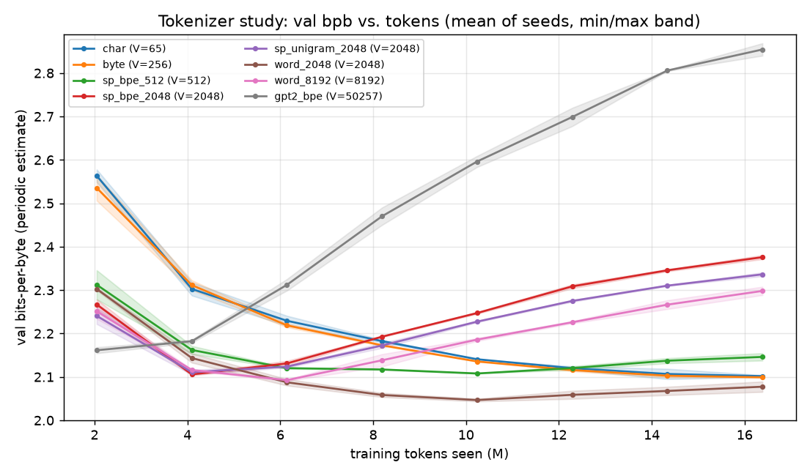 | 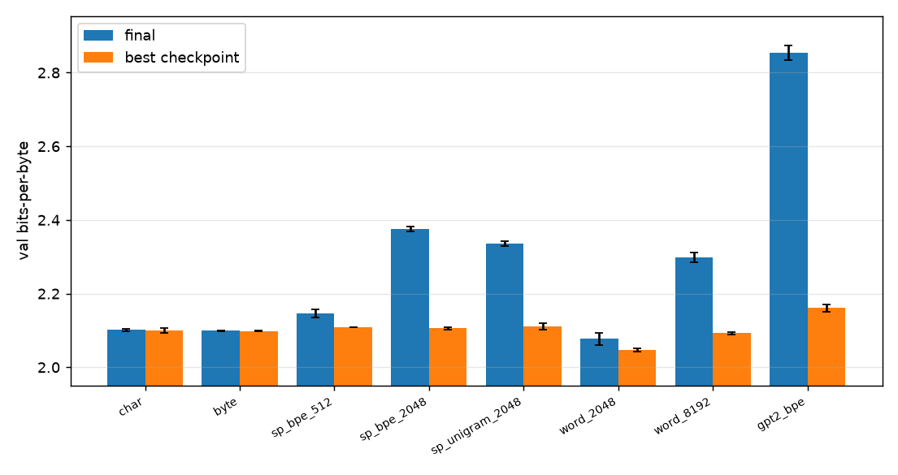 |

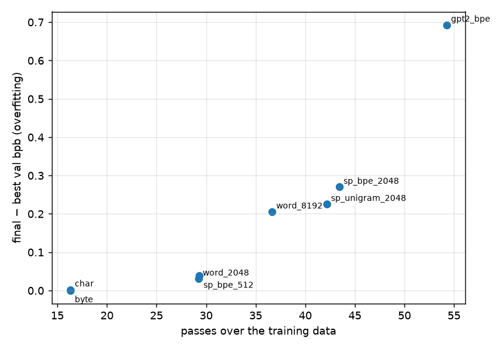

**Figure 1.3.** Overfitting (final − best bpb) against passes over the data. It is ~0 below 17
passes and grows steadily with passes.

### 1.4 Analysis

- **Final ranking ≠ best ranking.** By final bpb, `word_2048` < `byte` ≈ `char` < `sp_bpe_512` ≪
  the 2k/8k/50k vocabularies. By best bpb, all eight lie within 0.12 bpb, and all but `gpt2_bpe`
  lie within 0.06. The two word vocabularies beat characters at their best checkpoints (`word_2048`
  2.047, `word_8192` 2.093 vs. `char` 2.100). The three subword vocabularies are within 0.01 of
  characters.
- **Overfitting tracks passes over the data** (Figure 1.3). The one exception is `word_8192`: it
  has fewer passes than the two 2k subword vocabularies but overfits about as much, because its embedding is
  4× larger (2.1M vs. 0.5M parameters). Both effects push in the same direction: more passes and more
  parameters per byte of training text.
- **`gpt2_bpe` is the extreme case:** 54 passes and a 12.9M-parameter embedding (4× the rest of the
  model) on 1 MB of text. Its best is at step 250, and the final model is 0.69 bpb worse.

### 1.5 Fixing the overfitting of `gpt2_bpe` (Task 1b)

**Hypotheses** (one change per run, 2 seeds, eval every 50 steps; `sweeps/laptop_tokenizer_fix.yaml`):

| run | change | hypothesis |
|---|---|---|
| `gpt2_baseline` | none (re-run of 1a) | — |
| `gpt2_early_stop` | `max_steps: 250`, chosen from seed 1337's best step in 1a | training ends at the best point, with the LR fully decayed |
| `gpt2_early_stop_500` | `max_steps: 500` | sensitivity check of the stopping step |
| `gpt2_dropout` | dropout 0.1 → 0.3 | more regularization delays memorization |
| `gpt2_dropout_wd` | dropout 0.3 + weight decay 0.1 → 0.3 | as above, more strongly |
| `gpt2_small` | `dim` 256 → 128 | a smaller embedding table memorizes less |

**Rule against leakage.** Choosing a stopping step from the validation curve uses val for model
selection. So the step is chosen on seed 1337 of the *1a sweep*. Seed 42 is the out-of-sample check,
and the 500-step run is reported as a sensitivity check, not as the chosen fix.

| run | final val bpb (s42 / s1337) | Δ vs. baseline (per seed) | resolved? | best val bpb (step s1337/s42) | tokens |
|---|---:|---:|---|---:|---:|
| `gpt2_baseline` | 2.854 ± 0.020 (2.869 / 2.840) | — | — | 2.131 / 2.138 (400/300) | 16.4M |
| `gpt2_early_stop` (250) | 2.237 ± 0.001 | **−0.617** (−0.632 / −0.602) | yes | = final | 2.0M |
| `gpt2_early_stop_500` | **2.141 ± 0.007** | **−0.713** (−0.732 / −0.694) | yes | 2.131 / 2.134 (450/450) | 4.1M |
| `gpt2_dropout` | 2.354 ± 0.004 | −0.500 (−0.511 / −0.489) | yes | 2.140 / 2.164 (500/450) | 16.4M |
| `gpt2_dropout_wd` | 2.355 ± 0.001 | −0.499 (−0.513 / −0.485) | yes | 2.143 / 2.164 (500/500) | 16.4M |
| `gpt2_small` | 3.173 ± 0.015 | **+0.319** (+0.315 / +0.323) | yes (worse) | 2.182 / 2.165 (550/550) | 16.4M |

Noise floor 0.006 bpb.

| Learning curves | Final bpb |
|---|---|
| 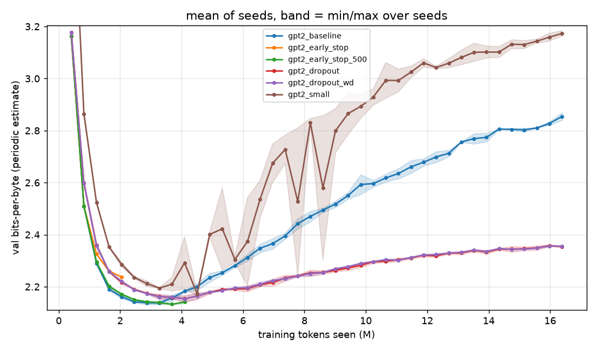 | 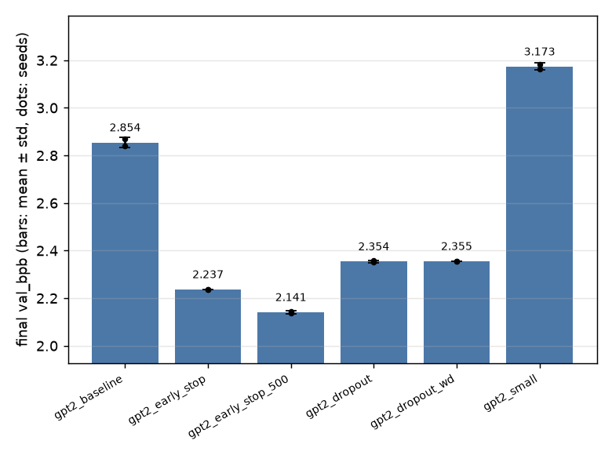 |

**Interpretation.**
- **Early stopping is the best fix**, but the step chosen by the honest rule (250) is too early. With
  100 warmup steps, a 250-step run spends 40% of its schedule warming up and sees only 2M tokens.
  It underfits: its final train loss is 4.28 nats/token against 3.53 for the 500-step run, and its
  val loss is 4.79 against 4.59.
  Stopping at 500 steps gives 2.141. That is within 0.01 of the baseline's best checkpoint, and it
  costs 4× less compute. The 1a grid (eval every 250 steps) was too coarse: with eval every 50 steps,
  the baseline's best is at step 300–400, not 250. **Lesson:** pick the stopping step from a finely
  sampled curve, and do not stop inside the warmup-dominated part of the schedule.
- **Dropout/weight decay delay overfitting but do not raise the ceiling.** Final bpb improves by 0.50,
  but the best checkpoint (2.14–2.16) is no better than the baseline's best (2.13–2.14), and the
  curve still turns up after step ~500. Weight decay 0.3 adds nothing over dropout alone (+0.001).
- **The smaller embedding is a negative result, and it is not a bug.** `dim: 128` shrinks the
  Transformer 4× (3.15M → 0.79M non-embedding parameters) but the embedding only 2× (12.9M → 6.4M
  parameters). Memorization capacity therefore stays large while modeling capacity falls, and the
  model is worse at both its best (2.17) and its final checkpoint (3.17). The curve has the same
  shape as the baseline's, shifted up, so the run trained normally. A clean test of "smaller
  embedding" needs a factorized embedding (V × e + e × d), which would need new model code.
- **More data** is the textbook fix. It cannot be tested here, because the corpus is fixed at 1 MB.
  Task 2 is effectively that experiment: on the 100M-token FineWeb shard, no run sees the data more
  than once, and no val curve turns up.

---

## Task 2 — The training recipe

### 2.1 Question and hypothesis

Which parts of the modern recipe (RMSNorm/RoPE, the WSD schedule, the Muon optimizer) matter at a
16M-token budget, and does the ranking match the tutorial's 49M-token result (§2.2.2)?
**Hypothesis:** as in the tutorial, the optimization changes (WSD, Muon) give the largest gains, and
the architecture change is small.

### 2.2 Setup

| Item | Value |
|---|---|
| Base config | `laptop/L4q_gpt_fineweb_quick.yaml`: 4 × 256 × 4 heads, GELU MLP, FineWeb sp1024, seq 512 |
| Budget | 1,000 steps × 16,384 tokens = **16.4M tokens**; ≈ 3.1e14 FLOPs (3.15M non-emb params) |
| Seeds | 1337, 42 |
| Sweep | `sweeps/laptop_recipe_quick.yaml`; eval every 100 steps |

L4q inherits Muon, WSD, lr 3e-3 and SwiGLU from L4, so every row sets the MLP, optimizer, LR and
schedule explicitly. All rows use GELU, so each row differs from the row above in exactly one
respect (SwiGLU is the extra credit).

| run | norm / position / bias | optimizer | schedule |
|---|---|---|---|
| `textbook` | LayerNorm / learned / bias | AdamW lr 1e-3 | cosine → 0.1 |
| `rmsnorm_rope` | RMSNorm / RoPE / no bias | AdamW lr 1e-3 | cosine → 0.1 |
| `wsd_adamw` (control) | RMSNorm / RoPE | AdamW lr 1e-3 | WSD (warmdown 30%) |
| `muon_wsd` | RMSNorm / RoPE | Muon (matrix lr 0.02, Adam lr 3e-3) | WSD |
| `muon_cosine` (2nd control) | RMSNorm / RoPE | Muon | cosine → 0.1 |

`wsd_adamw` is the §2.2.2 control: it separates the schedule from the optimizer. `muon_cosine`
completes a **2×2 factorial** (schedule × optimizer), which also measures their interaction.

### 2.3 Results at 16.4M tokens

| run | val bpb (s42 / s1337) | train time | tok/s |
|---|---:|---:|---:|
| `textbook` | 2.489 ± 0.004 (2.486 / 2.492) | 9.6 s | 1.68M |
| `rmsnorm_rope` | 2.124 ± 0.002 (2.126 / 2.123) | 11.4 s | 1.41M |
| `wsd_adamw` | 2.067 ± 0.000 (2.068 / 2.067) | 12.0 s | 1.39M |
| `muon_wsd` | **1.826 ± 0.002** (1.825 / 1.828) | 15.6 s | 1.06M |
| `muon_cosine` | 1.840 ± 0.006 (1.835 / 1.844) | 15.6 s | 1.05M |

**Paired differences** (noise floor 0.002):

| comparison (B − A) | what it measures | mean | per seed | p | resolved? |
|---|---|---:|---|---:|---|
| `rmsnorm_rope` − `textbook` | architecture | **−0.365** | −0.361 / −0.369 | 0.007 | yes |
| `wsd_adamw` − `rmsnorm_rope` | schedule, with AdamW | −0.057 | −0.058 / −0.056 | 0.013 | yes |
| `muon_wsd` − `wsd_adamw` | optimizer, with WSD | **−0.241** | −0.243 / −0.239 | 0.005 | yes |
| `muon_cosine` − `rmsnorm_rope` | optimizer, with cosine | −0.285 | −0.290 / −0.279 | 0.012 | yes |
| `muon_wsd` − `muon_cosine` | schedule, with Muon | −0.013 | −0.011 / −0.016 | 0.12 | yes (small) |
| `muon_wsd` − `textbook` | whole recipe | −0.663 | −0.662 / −0.664 | 0.001 | yes |

**2×2 factorial** (cells `rmsnorm_rope`, `wsd_adamw`, `muon_cosine`, `muon_wsd`):

| effect | mean | per seed | p |
|---|---:|---|---:|
| main effect of WSD | −0.035 | −0.034 / −0.036 | 0.012 |
| main effect of Muon | **−0.263** | −0.267 / −0.259 | 0.009 |
| interaction (WSD gain with Muon − without) | +0.044 | +0.047 / +0.040 | 0.054 |

| Learning curves (16.4M tokens) | Final bpb |
|---|---|
| 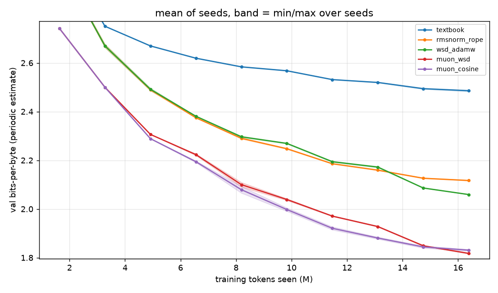 | 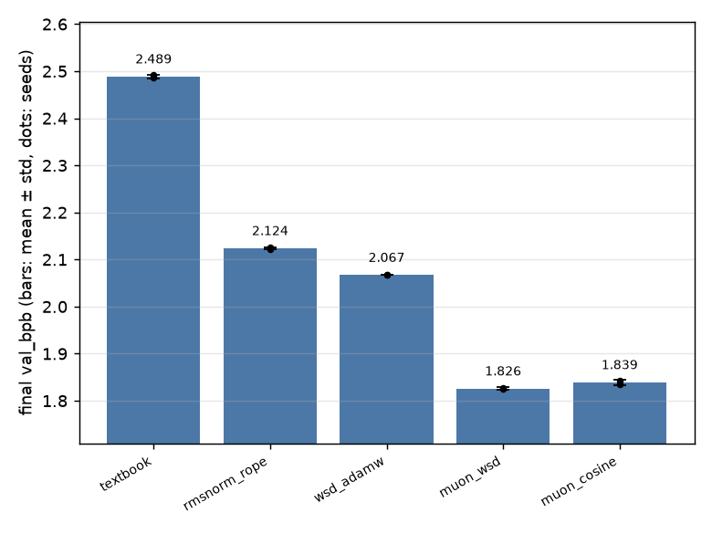 |

At this budget **Muon is the largest optimizer effect** (−0.26 main effect). WSD helps much
less with Muon (−0.013) than with AdamW (−0.057). The positive interaction says the two gains
overlap: both get more out of a short run. The curves show where WSD's gain comes from: `wsd_adamw`
tracks `rmsnorm_rope` (slightly *behind*, because its LR is higher) until the warmdown starts at
step 700, then drops below it in the last 30% of training.

### 2.4 Diagnostic: why is the architecture gain −0.37 here but −0.046 in the tutorial?

The −0.365 for `rmsnorm_rope` − `textbook` is 8× the tutorial's −0.046 at 49M tokens. That could
be a bug (for example a broken LayerNorm path), or something real. `sweeps/laptop_recipe_decomp.yaml`
changes one component of `textbook` at a time (same AdamW + cosine, 2 seeds):

| run | change vs. `textbook` | val bpb | Δ vs. textbook (per seed) | resolved? |
|---|---|---:|---:|---|
| `textbook` | — | 2.489 ± 0.004 | — | — |
| `tb_rope` | learned positions → **RoPE** | 2.112 ± 0.001 | **−0.377** (−0.374 / −0.381) | yes |
| `tb_rmsnorm` | LayerNorm → RMSNorm | 2.490 ± 0.006 | +0.001 (−0.001 / +0.002) | not resolved |
| `tb_nobias` | bias → no bias | 2.499 ± 0.002 | +0.010 (+0.014 / +0.006) | yes (worse) |
| `tb_nope` | learned positions → **none** (NoPE) | 2.508 ± 0.001 | +0.019 (+0.021 / +0.016) | yes (worse) |
| `rr_learned` | RMSNorm/no bias + learned positions | 2.499 ± 0.003 | `rmsnorm_rope` − this: **−0.375** | yes |

| Learning curves | Final bpb |
|---|---|
| 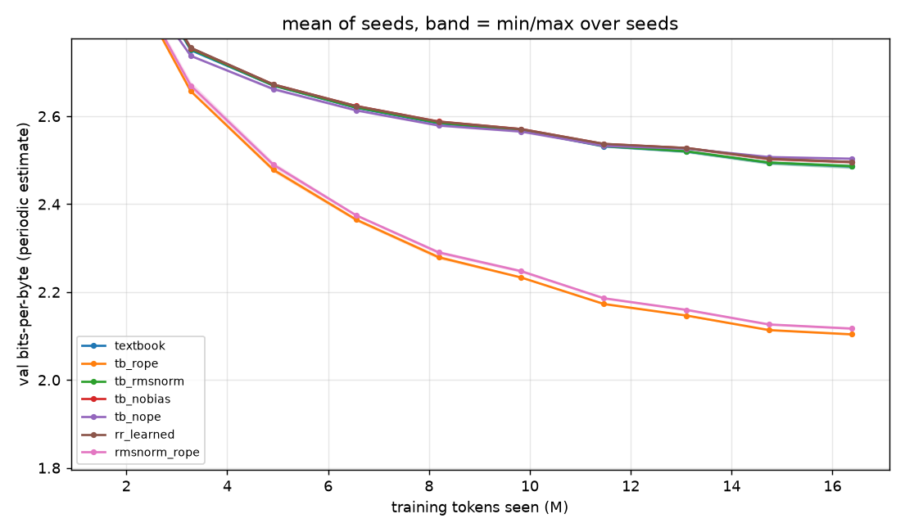 | 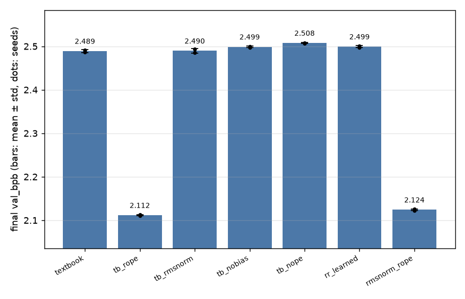 |

**The whole gain is RoPE; RMSNorm and removing the bias do nothing (or slightly hurt).** The
cause is visible in the curves: with learned position embeddings, the model sits on a **plateau**
at ~2.5–2.6 bpb, only 0.02 better than a model with *no* position information (`tb_nope`).
After 16M tokens it has barely learned to use its position embeddings. RoPE builds relative position into attention from
step 0, so it has no plateau. The full-size runs (§2.5) confirm this: there the textbook model
leaves the plateau between steps 750 and 1,250 (val bpb 2.47 → 2.12, ~12–20M tokens) and then
nearly catches up. This is a **real budget effect, not a bug**: `tb_rmsnorm` and `textbook` agree to
0.001, which rules out a broken norm path, and the gap closes with more tokens.

### 2.5 The same recipe at the full L4 budget (49M tokens)

Same five rows at full `laptop/L4_gpt_fineweb.yaml` size: 6 × 384 × 6 heads (10.6M non-embedding params),
3,000 steps × 16,384 tokens = **49.2M tokens**, ≈ 3.1e15 FLOPs (10× Task 2). `sweeps/laptop_recipe_full.yaml`.
`rmsnorm_rope` (± 0.032) and `wsd_adamw` (± 0.014) had a large seed spread with 2 seeds, so this sweep
was extended to **4 seeds** (1337, 42, 7, 2024).

| run | ours, 16.4M tok (L4q) | ours, 49M tok (L4), 4 seeds | tutorial §2.2.2, 49M tok |
|---|---:|---:|---:|
| `textbook` | 2.489 | 1.787 ± 0.003 | 1.790 ± 0.001 |
| `rmsnorm_rope` | 2.124 | 1.750 ± 0.022 | 1.744 ± 0.010 |
| (+ SwiGLU) | — | — | 1.786 ± 0.013 |
| `wsd_adamw` | 2.067 | 1.697 ± 0.010 | 1.728 ± 0.010 (with SwiGLU) |
| `muon_wsd` | 1.826 | **1.613 ± 0.002** | 1.647 ± 0.010 (with SwiGLU) |
| `muon_cosine` | 1.840 | **1.611 ± 0.002** | — |

**Paired differences, 16.4M vs. 49M tokens** (4 seeds at 49M; noise floor 0.003):

| comparison | 16.4M tokens | 49M tokens (per seed s7 / s42 / s1337 / s2024) | p (49M) | resolved at 49M? |
|---|---:|---|---:|---|
| `rmsnorm_rope` − `textbook` (architecture) | **−0.365** | −0.037 (−0.047 / −0.018 / −0.066 / −0.019) | 0.05 | yes |
| `wsd_adamw` − `rmsnorm_rope` (schedule, AdamW) | −0.057 | −0.053 (−0.052 / −0.061 / −0.036 / −0.062) | 0.003 | yes |
| `muon_wsd` − `wsd_adamw` (optimizer, WSD) | −0.241 | **−0.084** (−0.082 / −0.090 / −0.074 / −0.091) | <0.001 | yes |
| `muon_cosine` − `rmsnorm_rope` (optimizer, cosine) | −0.285 | **−0.139** | 0.001 | yes |
| `muon_wsd` − `muon_cosine` (schedule, Muon) | −0.013 | +0.001 (+0.001 / +0.003 / +0.000 / +0.001) | 0.09 | **not resolved** |
| main effect of WSD | −0.035 | −0.026 | 0.003 | yes |
| main effect of Muon | −0.263 | **−0.112** | 0.001 | yes |
| interaction | +0.044 | **+0.054** | 0.004 | yes |
| `muon_wsd` − `textbook` (whole recipe) | −0.663 | −0.175 | <0.001 | yes |

| Learning curves (49M tokens) | Final bpb |
|---|---|
| 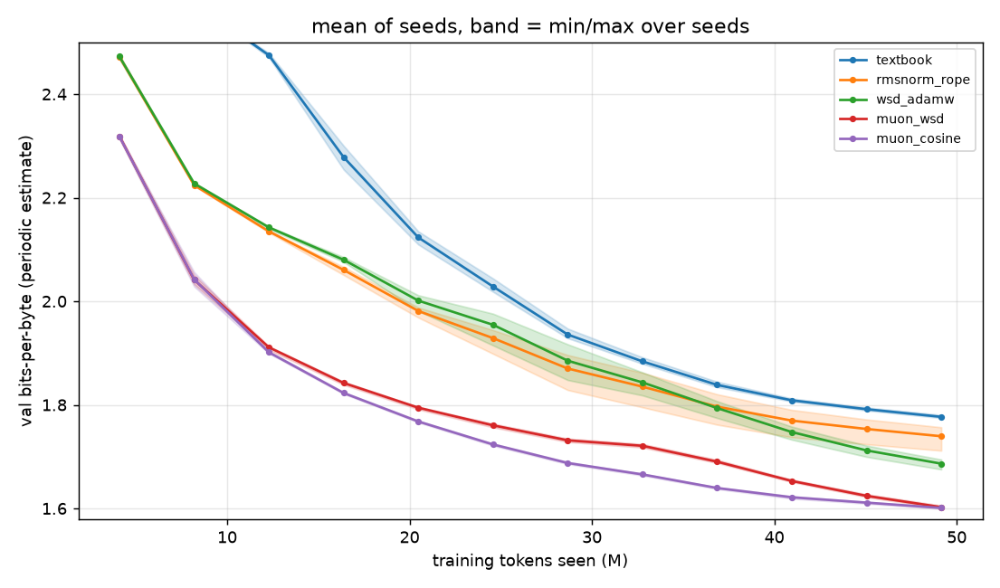 | 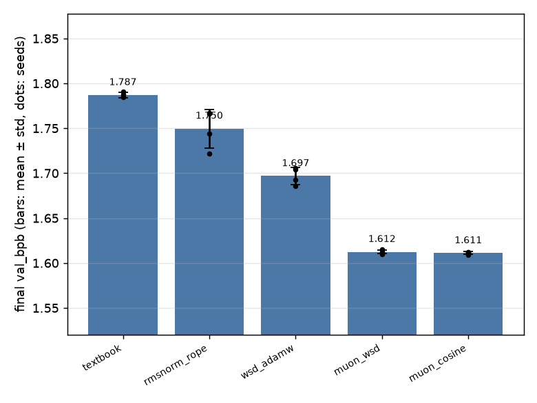 |

**What moved with the budget:**
- **Our numbers reproduce the tutorial's.** `textbook` (1.787 vs. 1.790) and `rmsnorm_rope` (1.750 vs.
  1.744) agree within the seed noise. Our `wsd_adamw` and `muon_wsd` are 0.03 better than the
  tutorial's rows, which also contain SwiGLU. That fits the extra-credit finding that SwiGLU *hurts* at this
  budget. (Ours is evaluated on the first 2.1M val tokens, the tutorial's on 4.2M, so small offsets
  are expected.)
- **The architecture gain shrinks 10×** (−0.365 → −0.037), from the largest effect to the smallest.
  It was mostly the learned-position plateau (§2.4), which the textbook model leaves at ~12–20M
  tokens.
- **Muon stays the largest effect, but shrinks 2–2.5×** (main effect −0.26 → −0.11). Muon's
  advantage is largest early (the curves are ~0.18 apart at 8M tokens) and narrows as AdamW catches up.
- **The WSD gain exists only with AdamW.** With AdamW, WSD is worth −0.05 at both budgets. With
  Muon it is worth −0.013 at 16M and nothing at 49M (+0.001, not resolved). The interaction is
  significant at 49M (+0.054, p = 0.004). One plausible reason: Muon's orthogonalized updates already
  have a fixed size, so the late LR decay that WSD concentrates at the end matters less.
- **An unexplained seed effect.** The RoPE/AdamW rows have a 3–10× larger seed spread than the
  textbook and Muon rows (± 0.022 vs. ± 0.003), and their seeds split into two groups
  (1.72/1.74 vs. 1.77/1.77). No run has a loss spike: the seeds drift apart smoothly after ~20M
  tokens. I believe this is real optimization variance of AdamW + RoPE at lr 1e-3, not a bug,
  because the same code with Muon is tight (± 0.002). It is the reason for the extra seeds.

---

## Task 3 — Scaling plot

### 3.1 Question and hypothesis

At a fixed token budget, how does val bpb fall with model size, and does it flatten? With
D = 16.4M tokens, Chinchilla's D ≈ 20N rule puts the compute-optimal model at N ≈ 0.8M parameters.
**Hypothesis:** bpb keeps falling with N, with smaller gains per doubling beyond ~1M parameters.
A 2× token budget should then be worth more than a 2× model for all but the smallest sizes.

### 3.2 Setup

The recipe is Task 2's best row (`muon_wsd`: RMSNorm/RoPE, GELU, Muon + WSD). Other settings: seq 512,
16,384 tokens/step, `n_heads = dim / 64`, `max_time_sec: 0` (every size sees exactly D tokens). Six sizes ×
two budgets × 2 seeds = 24 runs (`sweeps/laptop_scaling.yaml`, `laptop_scaling_2x.yaml`):

| run | dim × layers | non-emb params | D/N at D₁ | FLOPs at D₁ = 16.4M | FLOPs at D₂ = 32.8M | peak memory |
|---|---|---:|---:|---:|---:|---:|
| `s0` | 128 × 2 | 0.39M | 41.6 | 3.9e13 | 7.7e13 | 0.3 GB |
| `s1` | 192 × 3 | 1.33M | 12.3 | 1.3e14 | 2.6e14 | 0.4 GB |
| `s2` | 256 × 4 | 3.15M | 5.2 | 3.1e14 | 6.2e14 | 0.6 GB |
| `s3` | 384 × 6 | 10.62M | 1.5 | 1.0e15 | 2.1e15 | 1.2 GB |
| `s4` | 512 × 8 | 25.17M | 0.7 | 2.5e15 | 5.0e15 | 2.1 GB |
| `s5` | 768 × 8 | 56.64M | 0.3 | 5.6e15 | 1.1e16 | 3.4 GB |

### 3.3 Results

| run | bpb @ D₁ (16.4M) | gain vs. next smaller | bpb @ D₂ (32.8M) | gain vs. next smaller | train time D₁ / D₂ |
|---|---:|---:|---:|---:|---:|
| `s0` | 2.105 ± 0.005 | — | 2.030 ± 0.004 | — | 9 s / 18 s |
| `s1` | 1.906 ± 0.003 | −0.199 | 1.807 ± 0.001 | −0.223 | 13 s / 25 s |
| `s2` | 1.827 ± 0.002 | −0.080 | 1.735 ± 0.002 | −0.072 | 16 s / 31 s |
| `s3` | 1.764 ± 0.001 | −0.063 | 1.664 ± 0.001 | −0.072 | 33 s / 66 s |
| `s4` | 1.737 ± 0.001 | −0.026 | 1.627 ± 0.001 | −0.036 | 65 s / 131 s |
| `s5` | 1.725 ± 0.004 | −0.012 | 1.605 ± 0.003 | −0.023 | 128 s / 257 s |

| bpb vs. non-embedding parameters | bpb vs. training FLOPs |
|---|---|
| 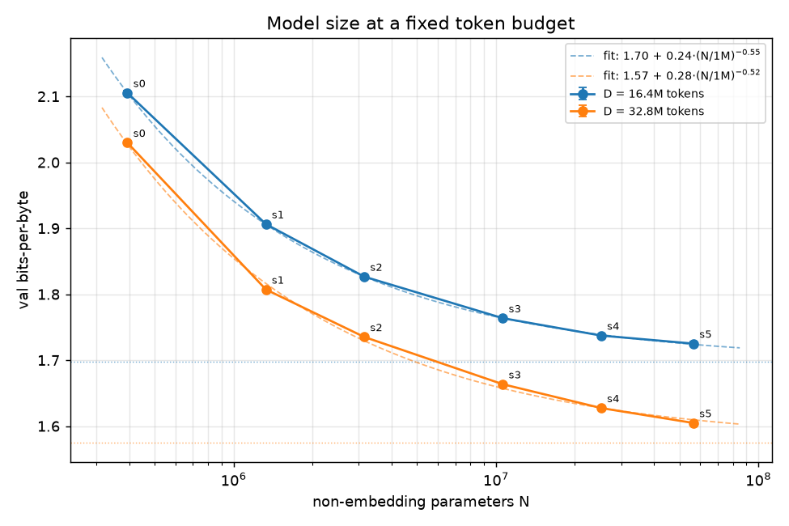 | 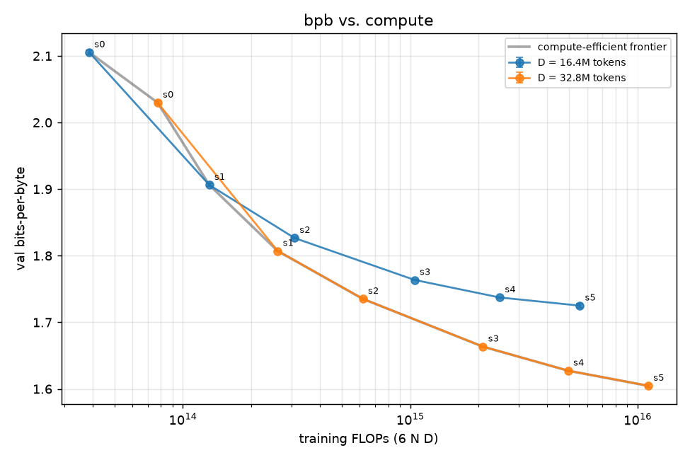 |

Fit L(N) = E + A · (N / 1M)^(−α) to each budget:

| D | E (asymptote at this D) | A | α |
|---:|---:|---:|---:|
| 16.4M | 1.698 | 0.243 | 0.554 |
| 32.8M | 1.575 | 0.279 | 0.517 |

### 3.4 Analysis

- **The curve flattens.** At D₁, the gain per size step falls from −0.20 (s0 → s1) to −0.012
  (s4 → s5, 2.25× more parameters). The fit's asymptote E = 1.70 is only 0.03 below s5. E is
  the floor *set by the 16.4M-token budget*, not an irreducible loss: doubling D lowers it by 0.12,
  to 1.58.
- **The gain per doubling of N shrinks steadily.** The size steps are not equal (1.2–1.75
  doublings each), so normalize per doubling. At D₁ the gain is −0.113, −0.064, −0.036, −0.021,
  −0.010 bpb per doubling from s0→s1 to s4→s5. At D₂ it is −0.127, −0.058, −0.041, −0.029, −0.019.
  **More data delays the flattening:** from s2 on, each doubling of N is worth 1.1–1.9× more at D₂
  than at D₁. s4 and s5 see less than one token per parameter at D₁, so they are badly under-trained.
- **The FLOPs plot gives the answer to Q3.** Every D₂ point from s1 up lies on the
  compute-efficient frontier, and every D₁ point except s0 and s1 lies above it. For example
  `s2 @ D₂` (6.2e14 FLOPs) reaches 1.735, better than `s3 @ D₁` (1.764 at 1.0e15 FLOPs), with 40%
  less compute.
- **Not a bug:** the seed std is ≤ 0.005 everywhere, and the ordering is monotone in both N and D.
  The two budgets give consistent exponents (α ≈ 0.55 / 0.52).

**Limitations.** Muon's matrix LR (0.02) and the warmup (200 steps) were tuned for the 4 × 256 model
and were not re-tuned per size. The larger models could be slightly better with their own LR. The
6ND FLOPs count ignores attention (6 · L · T · d per token), which matters most for the small models
(at s0 it adds ~30%). Two budgets and six sizes are a small grid for a power-law fit.

---

## Report questions

### Q1. Why can't per-token loss be used to compare tokenizers?

Because a "token" is a different unit for each tokenizer. Per-token loss measures nats per
*token*, and a GPT-2 BPE token covers 3.09 bytes on average while a character covers 1.00.
The model with the bigger tokens must predict more information per token, so its per-token loss is
higher even when it models the text equally well. The Task 1 numbers:

| | `char` | `gpt2_bpe` (final) | ratio |
|---|---:|---:|---:|
| val loss (nats/token) | 1.457 | 6.118 | 4.2× |
| val perplexity | 4.3 | 454 | 106× |
| bytes/token | 1.00 | 3.09 | |
| **val bpb** = loss / ln 2 / (bytes/token) | **2.102** | **2.854** | 1.36× |

Perplexity says GPT-2 BPE is 100× worse. Bits per byte, which divides out the unit, says it is
36% worse at the end of training, and only 3% worse at its best checkpoint (2.161 vs. 2.100). The
two metrics do not even agree on the *ranking*: `word_2048` has 2.4× the perplexity of `char`
(10.3 vs. 4.3), yet it is the better model in bpb (2.077 vs. 2.102). In the other direction, a
tokenizer with *more* tokens per byte gets a lower per-token loss for free: `byte` has the lowest
per-token loss of all eight, but not the lowest bpb. Bits per byte measures every model on the same
fixed string of bytes, so it is the only one of these metrics that compares tokenizers.

### Q2. Which recipe change mattered most at your budget? Did any published improvement not reproduce? Why might that be?

**At 16.4M tokens (L4q), RoPE mattered most (−0.37), then Muon (−0.24 to −0.28), then WSD (−0.01
to −0.06).** The RoPE gain does not come from a better model. It comes from avoiding the
learned-position plateau that the textbook model has not yet left at 16M tokens (§2.4).

**At 49M tokens (L4), the ranking changes: Muon (−0.11 main effect) > WSD with AdamW (−0.05) >
RoPE/RMSNorm (−0.04).** The architecture change went from first place to last. That is the
lesson of this homework: an idea's measured value depends on the budget it is measured at.
RMSNorm (+0.001) and removing biases (+0.010) gave nothing on their own at 16M tokens (§2.4).

**Published improvements that did not reproduce here:**
1. **SwiGLU** (extra credit below). It helps at 16M tokens (−0.086), is not resolved at 49M
   (−0.012), and *hurts* at 98M (+0.051, worse on all 4 seeds, p = 0.048).
2. **WSD on top of Muon**: no gain at 49M (+0.001, not resolved).
3. **RMSNorm instead of LayerNorm**: no measurable effect at 16M tokens (+0.001).

**Why might that be?** Most published gains were measured on models 100–10,000× larger, trained on
1,000× more tokens, with hyperparameters tuned for the new component. Here: (a) **the budget is
small**, and an effect seen early in training can shrink or reverse later (RoPE, SwiGLU, Muon all
shrink from 16M to 49M); (b) **the LR was tuned for the baseline**: all AdamW rows use lr 1e-3, and
SwiGLU prefers a higher LR at 16M tokens; (c) **some benefits only appear at scale**: RMSNorm and
no-bias are mainly for speed and stability in large models, and our 4-layer models have neither
problem; (d) **some effects are below the noise floor**: with 2 seeds, differences under ~0.005–0.02 bpb
(depending on the sweep) cannot be resolved, which is why the high-variance rows got 4 seeds.

### Q3. With your compute, would you rather have a 2× larger model or 2× more tokens?

**2× more tokens**, for every model at or above ~1M parameters. The comparison uses equal compute:
FLOPs ∝ N · D, so doubling either doubles the cost. Starting from each size at D₁ = 16.4M:

| from | N | bpb now | 2× tokens (measured, D₂) | 2× model (fit at 2N, D₁) | better |
|---|---:|---:|---:|---:|---|
| `s0` | 0.39M | 2.105 | 2.030 | 1.976 | **2× model** (by 0.054) |
| `s1` | 1.33M | 1.906 | 1.807 | 1.840 | 2× tokens (by 0.032) |
| `s2` | 3.15M | 1.827 | 1.735 | 1.786 | 2× tokens (by 0.051) |
| `s3` | 10.62M | 1.764 | 1.664 | 1.743 | 2× tokens (by 0.079) |
| `s4` | 25.17M | 1.737 | 1.627 | 1.726 | 2× tokens (by 0.098) |
| `s5` | 56.64M | 1.725 | 1.605 | 1.716 (extrapolated) | 2× tokens (by 0.111) |

The "2× model" column uses the D₁ power-law fit at 2N, because the measured sizes are not exact
doublings. The answer can also be read off without the fit: the measured pairs at similar FLOPs (`s(k+1) @ D₁` vs.
`s(k) @ D₂`) agree for every k ≥ 1. The one exception is s0, the only model with D/N ≈ 42 > 20, i.e.
the only one that is over-trained by the Chinchilla rule. The crossover sits where Chinchilla
predicts it, and the advantage of more tokens grows with model size. My compute is cheap in tokens
(FineWeb has far more than 33M) and the models are tiny, so I would spend extra compute on tokens
until D/N ≈ 20, and only then on parameters.

---

## Extra credit — Why did SwiGLU not help in §2.2.2?

### EC.1 Question and hypotheses

In the tutorial (§2.2.2, 6 × 384, 49M tokens), adding SwiGLU to RMSNorm/RoPE made val bpb **worse**
(+0.042, p = 0.23), and halving its LR made it worse still. Three hypotheses, each tested with paired
seeds on the `rmsnorm_rope` row of Task 2 (4 × 256, AdamW lr 1e-3 + cosine;
`sweeps/laptop_swiglu.yaml`):

| | hypothesis | test |
|---|---|---|
| (i) | **learning rate**: SwiGLU needs a different LR | SwiGLU at lr 5e-4 / 1e-3 / 2e-3, 16.4M tokens |
| (ii) | **token budget**: SwiGLU's gain depends on how long it trains | GELU vs. SwiGLU at 16.4M / 49M / 98M tokens (1,000 / 3,000 / 6,000 steps, each with a full cosine schedule) |
| (iii) | **parameter count**: SwiGLU is handicapped by parameter matching | `swiglu_wide` (`mlp_mult: 6`, 1.5× the GELU MLP parameters) |

A note on (iii): nanolm's SwiGLU is *already* parameter-matched (`hidden = 2/3 · mlp_mult · dim` =
682 for dim 256, 3 matrices, the same parameter count as GELU's 2 matrices at hidden 1,024). So the useful test is the
opposite one: does giving SwiGLU *more* parameters change the picture?

### EC.2 Results

**(i) Learning rate and (iii) width, at 16.4M tokens** (2 seeds, noise floor 0.005):

| run | val bpb | Δ vs. `gelu` (per seed) | Δ vs. `swiglu` (per seed) |
|---|---:|---:|---:|
| `gelu` (lr 1e-3) | 2.124 ± 0.002 | — | |
| `swiglu` (lr 1e-3) | 2.038 ± 0.003 | **−0.086** (−0.090 / −0.082), p 0.03 | — |
| `swiglu_lr5e-4` | 2.111 ± 0.005 | −0.013 (−0.018 / −0.008) | **+0.073** (+0.072 / +0.074), p 0.01 |
| `swiglu_lr2e-3` | **2.014 ± 0.011** | −0.110 (−0.104 / −0.116) | −0.024 (−0.014 / −0.034), p 0.25 |
| `swiglu_wide` (mlp_mult 6) | 2.022 ± 0.001 | −0.102 (−0.104 / −0.100) | −0.016 (−0.014 / −0.018), p 0.08 |

| Learning curves (16.4M tokens) | Final bpb |
|---|---|
| 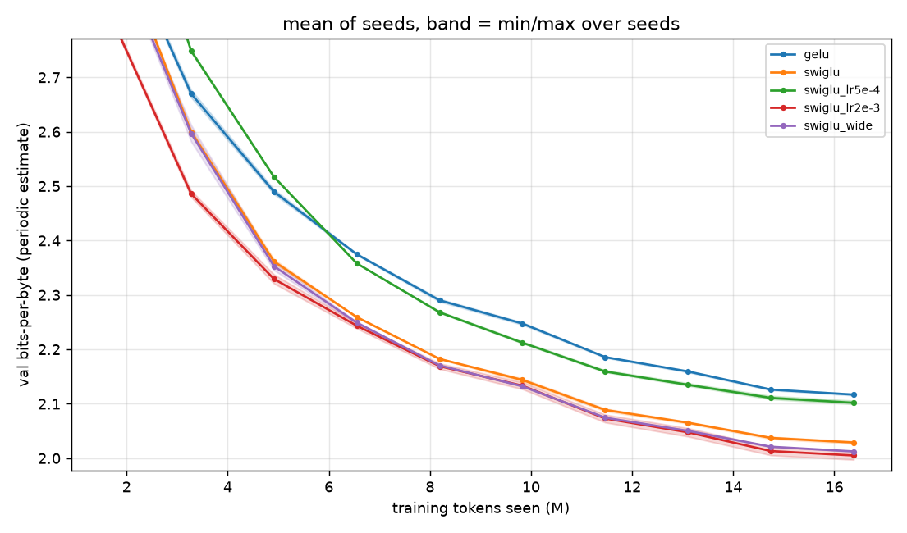 | 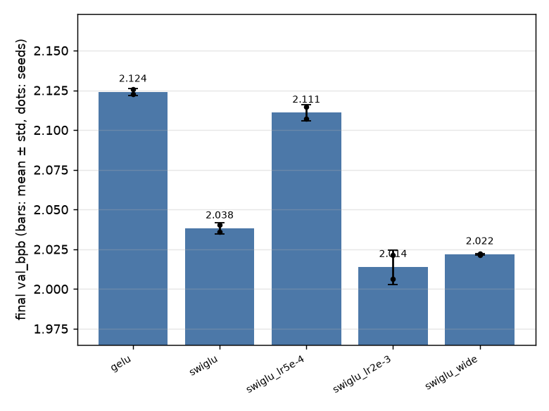 |

**(ii) Token budget** (the 49M and 98M rows have 4 seeds: s7 / s42 / s1337 / s2024; noise floor 0.004):

| tokens | `gelu` | `swiglu` | `swiglu` − `gelu` (per seed) | p | resolved? |
|---:|---:|---:|---|---:|---|
| 16.4M | 2.124 ± 0.002 | 2.038 ± 0.003 | **−0.086** (−0.090 / −0.082) | 0.03 | yes, SwiGLU better |
| 49M | 1.885 ± 0.013 | 1.874 ± 0.002 | −0.012 (−0.022 / +0.006 / −0.014 / −0.017) | 0.15 | not resolved |
| 98M | 1.732 ± 0.029 | 1.783 ± 0.004 | **+0.051** (+0.031 / +0.086 / +0.019 / +0.067) | 0.048 | **yes, SwiGLU worse** |

| Learning curves (16–98M tokens) | Final bpb |
|---|---|
| 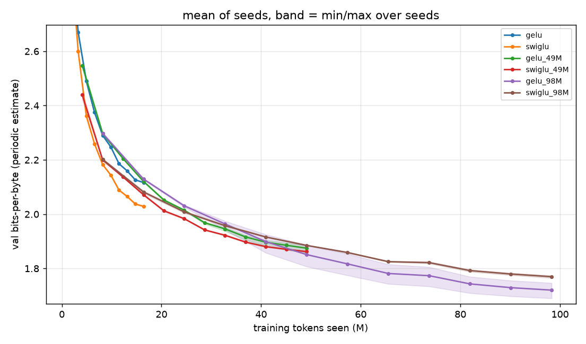 | 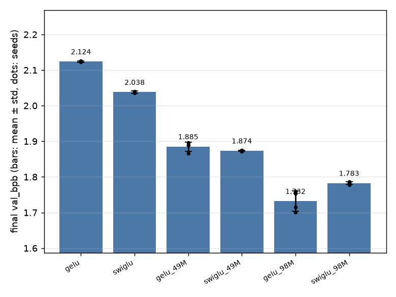 |

### EC.3 Analysis

- **(ii) Budget: supported. This is the main finding.** SwiGLU's advantage shrinks steadily with
  training and reverses: −0.086 → −0.012 → +0.051. Within the 98M runs, SwiGLU is ahead for the
  first ~35M tokens, and the curves cross at ~35–40M tokens. That matches the tutorial's description
  ("learned faster for the first ~1,500 steps [24M tokens], then fell behind") and its 49M result.
  SwiGLU learns faster early, but by this measure GELU ends better on longer runs.
- **(i) Learning rate: SwiGLU prefers a *higher* LR, not a lower one.** Halving the LR costs SwiGLU
  0.073 at 16M tokens (resolved), consistent with the tutorial's halved-LR run (1.814, worse). Doubling
  it gains another 0.024 (both seeds, but p = 0.25, so it is suggestive only). So the tutorial lowered
  the LR in the wrong direction. Our LR test was run only at 16M tokens, so it cannot say whether a
  higher LR also removes the 98M-token deficit. That is the next experiment.
- **(iii) Parameter count: not the explanation.** 1.5× more MLP parameters improves SwiGLU by only
  0.016, much less than the budget effect.
- **Bug or negative result? A genuine negative result at this scale.** Evidence against a bug:
  SwiGLU beats GELU by a resolved 0.086 at 16M tokens, it responds to the LR as expected, its seed
  spread is small (± 0.004), it has no loss spikes, and the sign flip is gradual and appears on all
  4 seeds. One caveat: `gelu_98M` has a large seed spread (± 0.029, the same two-group pattern as
  in §2.5). Even its worst seed (1.759) is better than SwiGLU's best (1.778), though.
- **Limitations:** a single small model (4 × 256, 3.15M params), one LR per budget, and every budget
  run uses its own full cosine schedule. The result says "SwiGLU does not help *at this size, LR and
  budget*". It does not refute SwiGLU, whose published gains come from far larger models.

---

## Conclusion and limitations

1. **Tokenizers** must be compared in bits per byte. On 1 MB of text, overfitting grows with
   passes over the data and with embedding size. GPT-2's 50k vocabulary ends 0.69 bpb above its best
   checkpoint. The best fix was early stopping with a fully decayed schedule at 500 steps (−0.71), at
   a quarter of the compute. The stopping step chosen from the coarse 1a curve (250) underfit;
   dropout fixed the final number but not the ceiling; a smaller model dimension made things worse.
2. **The training recipe:** the value of each change depends on the budget. At 16M tokens, RoPE
   looks like the biggest win (−0.37), but only because learned positions are still on a plateau. At
   49M tokens Muon is clearly the biggest (−0.11), WSD helps only with AdamW, and the architecture
   change is the smallest (−0.04). The 49M results reproduce the tutorial's numbers.
3. **Scaling:** at a fixed budget, bpb falls with model size, with steadily smaller gains per doubling
   (−0.11 → −0.01 per doubling of N at 16M tokens), so the curve flattens. With this compute I would
   spend a 2× budget on 2× tokens for every model above ~1M parameters.

**Limitations.**
- Small models (0.4–57M parameters) and budgets (16–98M tokens). Most published results are at
  ≥ 100M parameters and billions of tokens.
- Mostly 2 seeds. The paired t-test then has 1 degree of freedom, so the "resolved" rule (same sign,
  > 2× noise floor) carries most of the weight. The high-variance rows were extended to 4 seeds.
- LRs were not re-tuned per change or per size. The AdamW rows share lr 1e-3, and Muon's matrix LR
  is fixed at 0.02.
- Our FineWeb val bpb uses the first 2.1M val tokens, not the tutorial's 4.2M.
- The 1b stopping step and the "best checkpoint" numbers use the validation set for selection. Only
  seed 42 of `gpt2_early_stop` is a clean out-of-sample check.

---

## Reproduce

```bash
conda activate test
cd DeepDataMiningLearning/llm
python -m nanolm.prepare --golf-shards 1 --dest data/golf          # FineWeb sp1024 (~310 MB)

# Task 1a (16 runs, ~6 min) and 1b (12 runs, ~12 min)
python -m nanolm.sweep --sweep nanolm/configs/sweeps/laptop_tokenizers.yaml --seeds 1337 42
python -m nanolm.sweep --sweep nanolm/configs/sweeps/laptop_tokenizer_fix.yaml
# Task 2 (10 + 10 runs, ~4 min) and the full budget (20 runs incl. extra seeds, ~33 min)
python -m nanolm.sweep --sweep nanolm/configs/sweeps/laptop_recipe_quick.yaml
python -m nanolm.sweep --sweep nanolm/configs/sweeps/laptop_recipe_decomp.yaml
python -m nanolm.sweep --sweep nanolm/configs/sweeps/laptop_recipe_full.yaml
python -m nanolm.sweep --sweep nanolm/configs/sweeps/laptop_recipe_full.yaml --seeds 7 2024
# Task 3 (24 runs, ~27 min)
python -m nanolm.sweep --sweep nanolm/configs/sweeps/laptop_scaling.yaml
python -m nanolm.sweep --sweep nanolm/configs/sweeps/laptop_scaling_2x.yaml
# Extra credit (18 + 8 runs, ~16 min)
python -m nanolm.sweep --sweep nanolm/configs/sweeps/laptop_swiglu.yaml
python -m nanolm.sweep --sweep nanolm/configs/sweeps/laptop_swiglu.yaml --seeds 7 2024 \
    --only gelu_49M swiglu_49M gelu_98M swiglu_98M
```

Analysis (tables print to stdout and are written next to the runs; figures go to `figures/`):

```bash
F=docs/lm_from_scratch_part2/figures; S=outputs/nanolm/sweeps
python -m nanolm.tokenizer_table $S/laptop_tokenizers --figdir $F
python -m nanolm.analyze $S/laptop_tokenizers --baseline char --metric val_bpb
python -m nanolm.paired_diffs $S/laptop_tokenizer_fix --pairs gpt2_early_stop-gpt2_baseline \
    gpt2_early_stop_500-gpt2_baseline gpt2_dropout-gpt2_baseline gpt2_dropout_wd-gpt2_baseline gpt2_small-gpt2_baseline \
    --order gpt2_baseline gpt2_early_stop gpt2_early_stop_500 gpt2_dropout gpt2_dropout_wd gpt2_small \
    --figdir $F --prefix tokenizer_fix
for P in quick full; do
  python -m nanolm.paired_diffs $S/laptop_recipe_$P --pairs rmsnorm_rope-textbook wsd_adamw-rmsnorm_rope \
      muon_wsd-wsd_adamw muon_cosine-rmsnorm_rope muon_wsd-muon_cosine muon_wsd-textbook \
      --factorial rmsnorm_rope,wsd_adamw,muon_cosine,muon_wsd --factor-names WSD,Muon \
      --order textbook rmsnorm_rope wsd_adamw muon_wsd muon_cosine --figdir $F --prefix recipe_$P
done
python -m nanolm.paired_diffs $S/laptop_recipe_quick $S/laptop_recipe_decomp --pairs tb_rope-textbook \
    tb_rmsnorm-textbook tb_nobias-textbook tb_nope-textbook rmsnorm_rope-rr_learned \
    --order textbook tb_rope tb_rmsnorm tb_nobias tb_nope rr_learned rmsnorm_rope --figdir $F --prefix recipe_decomp
python -m nanolm.scaling_plot $S/laptop_scaling $S/laptop_scaling_2x --figdir $F
# run names that contain '-' (lr5e-4) need '--' as the pair separator
python -m nanolm.paired_diffs $S/laptop_swiglu --pairs swiglu--gelu swiglu_lr5e-4--gelu swiglu_lr2e-3--gelu \
    swiglu_wide--gelu swiglu_lr5e-4--swiglu swiglu_lr2e-3--swiglu \
    --order gelu swiglu swiglu_lr5e-4 swiglu_lr2e-3 swiglu_wide --figdir $F --prefix swiglu_lr
python -m nanolm.paired_diffs $S/laptop_swiglu --pairs swiglu--gelu swiglu_49M--gelu_49M swiglu_98M--gelu_98M \
    --order gelu swiglu gelu_49M swiglu_49M gelu_98M swiglu_98M --figdir $F --prefix swiglu_budget
```
